# Multiworld stochastic path tracer

A Rust + WGSL research playground that samples incompatible worlds during light transport. All intersections and path integration run in a **wgpu compute shader**. The interactive egui application uses eframe's winit window and shares its GPU device; headless mode runs the identical integrator without a window.

Choose each world independently from six presets. The app opens with a warm **Sunken temple** and a cool **Bioluminescent grove**. Switch either dropdown, swap A/B, or choose a suggested pairing without restarting. Every world shares the same coordinate space, so geometry, reflections and illumination can cross between them. Geometry and sampling are reproducible from an explicit integer seed.

## World presets

| World | What to explore |
| --- | --- |
| Sunken temple | Sandstone arcades, stepped platforms, a gold sun sculpture and amber lanterns. |
| Bioluminescent grove | Twisting branches, flattened mushroom caps, colored lantern pods and mossy rocks. |
| Lunar observatory | Three intersecting silver orbital rings, suspended planets and pedestal exhibits. |
| Neon district | A miniature skyline, open portal frames, cyan/magenta light rails and chrome spheres. |
| Warm spheres · original | The original warm sphere and mirror experiment. |
| Cool boxes · original | The original blue box and mirror experiment. |

| Sunken temple | Bioluminescent grove |
| --- | --- |
| 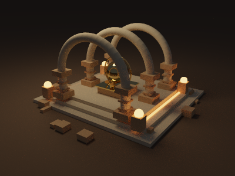 | 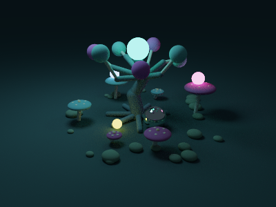 |

| Lunar observatory | Neon district |
| --- | --- |
| 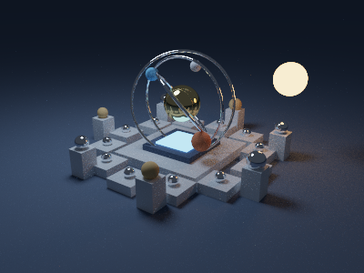 | 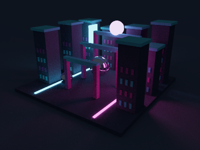 |

These are raw GPU captures at 400×300, 256 spp, seed 42; denoising is off. All new geometry is generated locally: native capsule beams form arches, roots and orbital rings; ellipsoids form broad mushroom caps. No asset download or external file path is required. Each set has a small number of sphere/box area lights supported by MIS.

Use **World A** and **World B** at the top of the sidebar. **Swap A ↔ B** swaps the selected scenes while preserving the current probability, camera and transport settings. **Suggested pairings** includes Temple × grove, Observatory × neon and the original pair. Selections work in all six transport modes, with spatial probability, primary-A locking, BVHs, MIS and denoising. Changing a preset resets raw accumulation and temporal history, including while paused; changing the seed regenerates the selected presets. Choosing the same preset in both slots produces identical worlds.

```sh
cargo run --release -- --world-a lunar-observatory --world-b neon-district
cargo run --release -- --world-a sunken-temple --world-b bioluminescent-grove --spatial
# Original experiment, including the original camera and scene generation:
cargo run --release -- --world-a warm-spheres --world-b cool-boxes
```

Regenerate the four preset thumbnails (and the mixed transport views) with:

```sh
cargo run --release -- --headless --all-modes --world-a sunken-temple --world-b bioluminescent-grove --width 400 --height 300 --samples 256 --spp 8 --output output/presets/temple-grove
cargo run --release -- --headless --all-modes --world-a lunar-observatory --world-b neon-district --width 400 --height 300 --samples 256 --spp 8 --output output/presets/observatory-neon
```

Generated renders, benchmark reports, build artifacts and locally packaged apps stay in ignored `output/`, `captures/`, `target/` and `release/` directories. The curated gallery PNGs in `docs/images/` are tracked.

The CLI defaults to Temple × grove. `Settings::default()` and `scene::worlds(seed)` retain the original scenes for existing library clients and benchmark reproducibility. `scene::selected_worlds(seed, presets)` generates any selected pair. Explicit `Renderer::set_worlds` uploads remain active until a preset or seed selection changes.

## Original experiment gallery

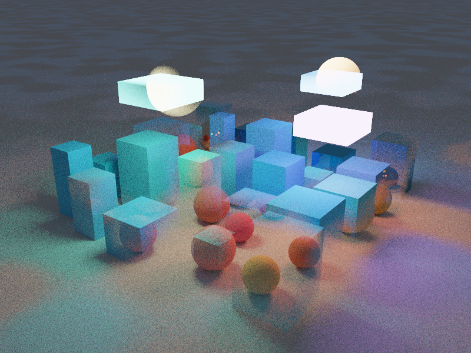

**Two incompatible worlds, one light path.** A world-space probability field selects sphere or box geometry at each segment; colored light and reflections can come from the other world.

| Independent sphere world | Independent box world |
| --- | --- |
| 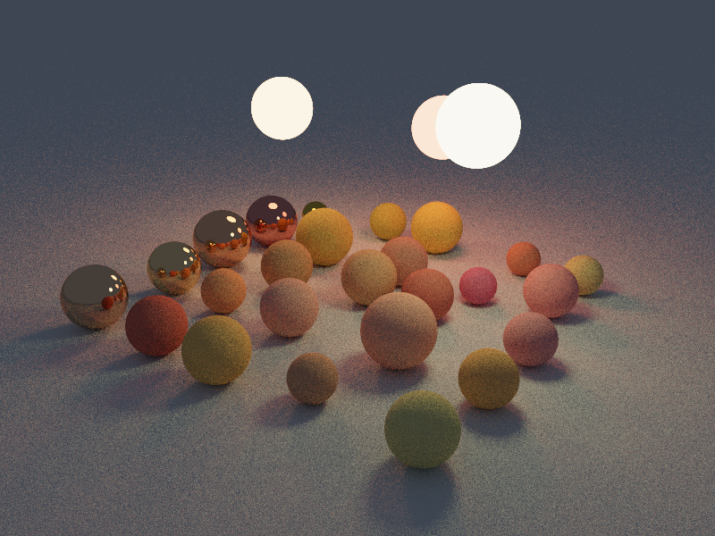 | 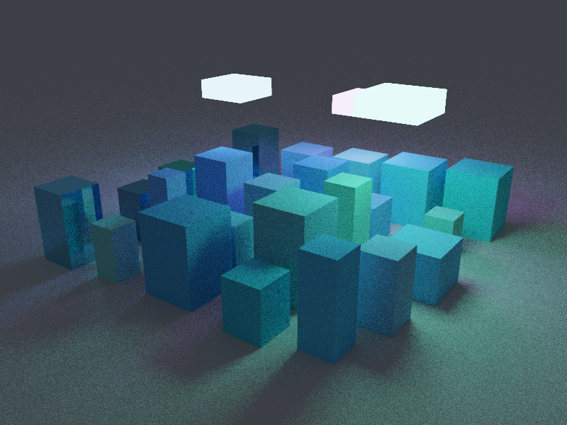 |

| Ordinary image blend | Independent switching at every bounce |
| --- | --- |
| 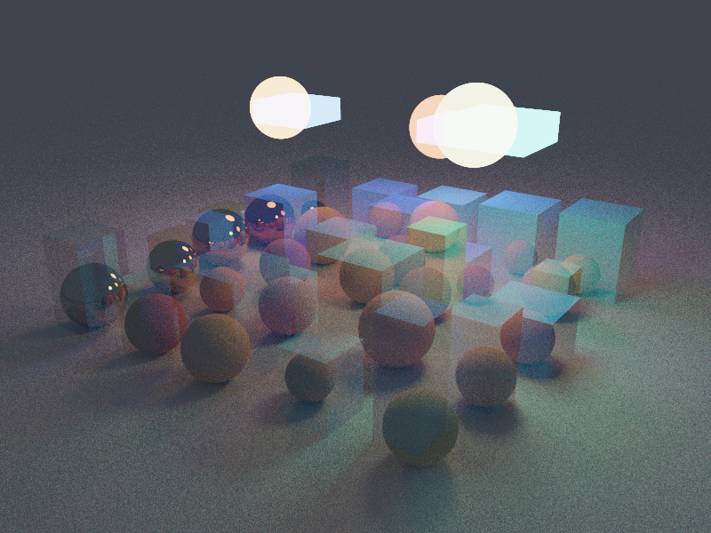 | 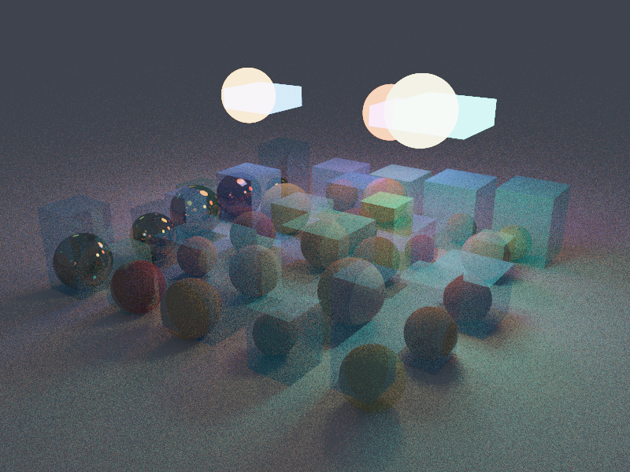 |

**Keep the visible geometry spherical, borrow another world's lighting.** Primary rays are locked to A; secondary rays choose A with probability 0.2. The cyan illumination and box-world occlusion are carried by secondary transport.

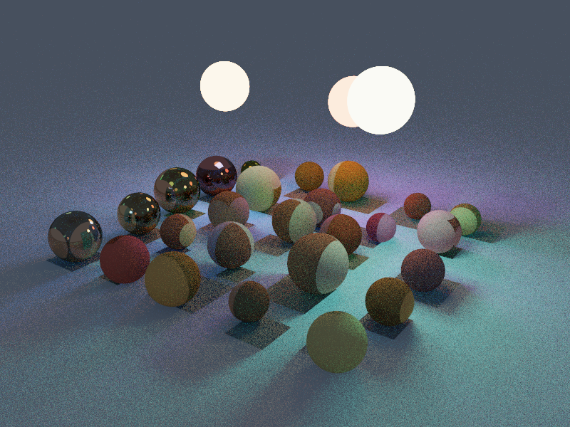

| World-space primary-selection frequency | Oriented surface normals |
| --- | --- |
| 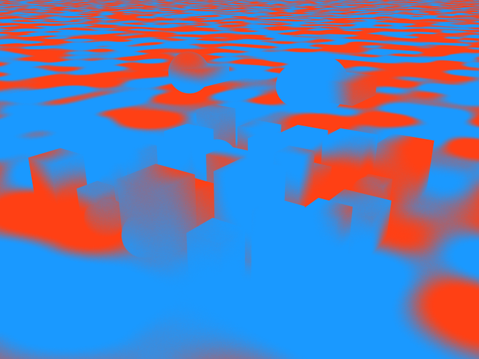 | 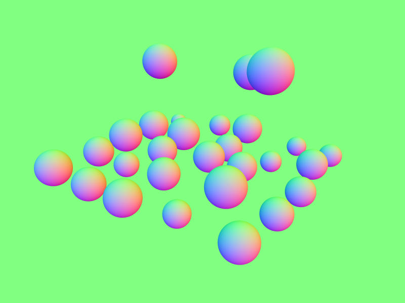 |

| Raw, 32 spp | Display filter, same 32 spp |
| --- | --- |
| 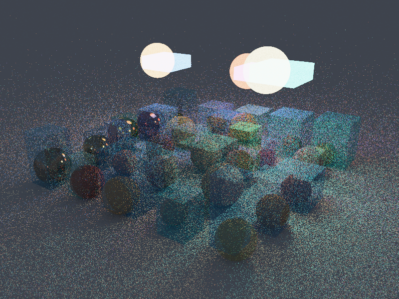 | 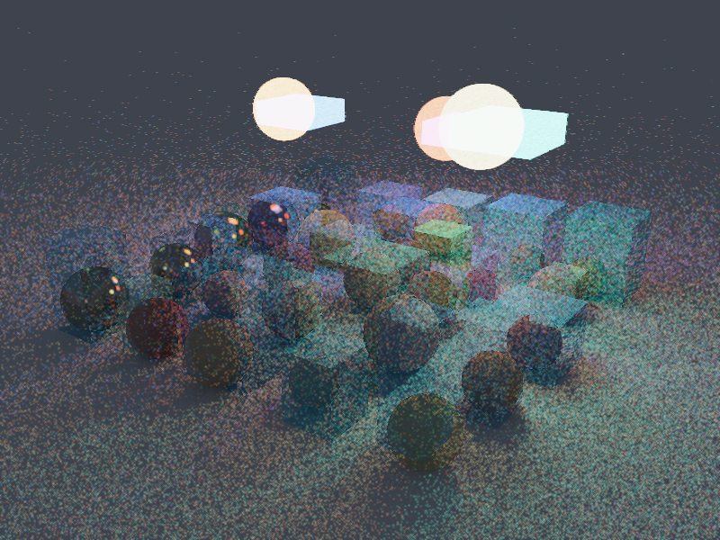 |

These are direct GPU render captures from this program. The radiance gallery uses **800×600, 512 spp, seed 42**, except the labeled 32-spp denoising pair. The filter is deliberately conservative and does not remove all fireflies; use raw estimates for transport comparisons. [Exact capture settings](docs/gallery-settings.md) and the [selection notes](docs/gallery-review.md) explain which images were chosen from the larger capture set. Regenerate these original-preset views with the current renderer with:

```sh
cargo run --release --example gallery -- --output output/gallery
```

## Build and run

The [Releases page](https://github.com/arkravitz/multiworld-path-tracer/releases) offers an Apple Silicon app and command-line binary. The published **v0.2.0** download contains the original sphere/box experiment; build the current source for the world selector and MIS improvements described here. To build from source, use Rust **1.95+** and a compute-capable GPU. Metal is used on macOS; Vulkan and DX12 are enabled on supported platforms. No CPU rendering fallback is supplied. The first build downloads dependencies; `Cargo.lock` pins the resolved versions.

```sh
cd multiworld-path-tracer
cargo run --release
```

The default render size is 800×600, independent of the window size. Start smaller on an M1 if needed:

```sh
cargo run --release -- --width 640 --height 480 --spp 1
```

Drag the image to orbit; scroll over it to zoom. Horizontal rotation wraps continuously in either direction. The Orbit control under Camera & resolution is an unlimited degree drag field, so it has no blocking endpoint. Controls provide independent World A/B presets, suggested pairings, world swapping, automatic BVH acceleration (with forced-BVH and linear reference options), all six modes, mixture probability, persistence, samples per frame, maximum depth, exposure in stops, seed, pause/resume, reset, PNG export, debug views, spatial probability, primary-world lock, camera sliders, and render dimensions. Open **Camera & resolution** and click **Apply resolution** to resize. The status area displays frame rate, accumulated spp, resolution, GPU, and backend. FPS is application presentation cadence, not a GPU timing query.

PNG captures normally go to `captures/` relative to the working directory. Finder-launched macOS app bundles use `Pictures/Multiworld Path Tracer` in your home folder. Expand **Export folder** to choose another location, or set `MULTIWORLD_CAPTURE_DIR` before launch. They match the displayed view, including exposure or debug visualization. Only explicit exports and tests read image data back to the CPU. Pausing preserves the estimates; display controls still work. Changing the seed regenerates both scenes as well as restarting the sample stream.

## Optional temporal denoising

Enable **Temporal denoise (display only)**, or pass `--denoise`. It combines a small geometry-guided spatial filter with motion-reprojected history. History stores guides for **both worlds**: hit position, oriented normal, material color/emission and mirror status. In mixed modes, both worlds must agree on the history correspondence, and their projected pixels must be within 1.5 pixels. This conservatively rejects ambiguous two-depth parallax instead of smearing one reality into the other.

Compatible stationary frames add only newly traced samples to history. Camera motion caps reused history at 32 samples and clamps its color against the current neighborhood; moving mirror surfaces reject temporal reuse. Disocclusions, geometry/material mismatch, seed/mode/probability/noise edits, explicit reset and resolution changes invalidate incompatible history. Exposure and debug-view changes do not double-count samples. Horizontal camera motion can preserve valid filtered history even though the raw progressive accumulator restarts.

This is a **biased preview filter**, not a replacement transport estimator or an implementation of full SVGF. It has no visibility into secondary-path correspondence and can retain noise or soften detail. The spatial check is especially conservative at boundaries between the two worlds. **Save PNG** exports the displayed image; **Save raw PNG** exports the unfiltered estimate without changing the image or history. Denoising defaults off, including headless comparisons. Raw radiance/debug sums remain untouched and tested against the unfiltered renderer.

Resources are allocated on first enable and cached until resize/exit. At 800×600, optional frame guides plus two temporal histories add about 154 MiB, for roughly 200 MiB including the original buffers and display texture. Filtering adds compute cost; keep it off for pure throughput measurements.

## Headless comparisons

```sh
cargo run --release -- --headless --all-modes \
  --width 640 --height 480 --samples 512 --spp 4 \
  --probability 0.5 --persistence 0.8 --seed 42 --output output/comparison
```

Produces six labeled PNG filenames (`01-world-a-512spp.png` through `06-persistent-512spp.png`) and `render-info.txt`, recording settings, camera, GPU/backend and elapsed time. All images use the same camera, resolution, seed, and spp. **The blend traces that sample budget in each world**, so its compute cost is approximately twice the other modes; this is equal spp, not equal time. No image-space blend is performed after tone mapping.

Render just one mode:

```sh
cargo run --release -- --headless --mode per-bounce --samples 2048 --spp 8
cargo run --release -- --headless --mode persistent --persistence 0.95 --samples 1024
cargo run --release -- --headless --mode per-bounce --primary-a --samples 1024 --output output/primary-a
cargo run --release -- --headless --mode per-bounce --spatial --samples 1024 --output output/spatial
# Exact linear reference, or force BVH even for tiny sphere-only worlds:
cargo run --release -- --headless --brute-force --samples 512 --output output/linear
cargo run --release -- --headless --force-bvh --samples 512 --output output/forced-bvh
cargo run -- --help
```

`--samples` is the total headless budget; `--spp` is samples per dispatch/frame. CLI dimensions are validated against the device's texture and storage limits. Accumulation is capped at 16 million spp to avoid exhausting the useful integer precision of f32 sums.

## What the six modes estimate

Let `p` be the probability of A, `s` the persistence, and `L_A`, `L_B` ordinary path-traced radiance in the independent scenes. Both worlds use the same constant environment `(0.045, 0.055, 0.075)`.

| Mode | World process | Expected image |
| --- | --- | --- |
| 1 · A only | Every segment queries A | `L_A` |
| 2 · B only | Every segment queries B | `L_B` |
| 3 · Image-space blend | Trace A and B independently; retain both linear estimates | `p L_A + (1-p) L_B` |
| 4 · Once per path | Choose A/B for the camera sample, keep it forever | Same expectation as mode 3, with different variance |
| 5 · Per bounce | Independently choose A/B for every ray segment, including the primary | Hybrid transport; generally differs from mode 3 |
| 6 · Persistent | Draw the initial world from p; at later segments keep it with probability s, otherwise redraw from p | A Markov hybrid process |

The transition matrix (rows = current A/B, columns = next A/B) is

```text
           A                   B
A     s + (1-s)p         (1-s)(1-p)
B       (1-s)p           s + (1-s)(1-p)
```

Thus `s=1` preserves the initial world (mode 4); `s=0` redraws independently (mode 5). A redraw can select the same world: `s` is **not** the overall probability of no switch. For constant `p`, the initial distribution `(p,1-p)` is stationary. At `p=1` or `p=0`, all mixed modes reduce to the corresponding single world, unless a probability override is enabled.

Each new segment starts at the previous hit in the shared coordinates, offset by `0.002` along its oriented normal. The new world's geometry may contain that origin. Sphere, box, capsule and ellipsoid queries support inside-origin exit intersections, and shading treats surfaces as two-sided. The world is selected before intersection, and misses terminate consistently in the environment. Emission is accumulated as `radiance += throughput * emission`.

Diffuse directions use cosine-weighted hemisphere sampling: `f = albedo/pi`, `pdf = cos(theta)/pi`, so the throughput multiplier is exactly albedo. Mirrors use delta reflection and colored reflectance. Russian roulette starts after the fourth surface, with survival clamped to `[0.05,0.95]` and throughput divided by survival. Maximum depth truncates the estimator in every mode consistently. Importance sampling is enabled by default: finite lights use power-weighted selection, sphere solid-angle sampling, visible box-face sampling, and MIS with cosine sampling. See the sampling details below.

**Per-bounce switching defines an artificial hybrid transport process, not physically correct transport through a conventional scene.** There is no division by `p` or `1-p`: the sampler estimates that process itself. Cross-world floor-to-light, reflector-to-cube, and sphere-to-box paths are the experiment, rather than an attempt to estimate either independent world's radiance.

## Importance sampling

**Importance sampling (MIS)** defaults on in the app and headless renderer. `--no-light-sampling` restores the original cosine-only estimator and independent world-selection stream. Toggling sampling resets accumulation and temporal history.

The implementation is tuned for this renderer's small sets of area lights:

- Light selection uses a CPU-built CDF weighted by surface area times emitted luminance. Its records share each world's BVH allocation after the logical node range; no extra storage bindings, frame buffers or temporal reservoirs are required. Scene replacement rebuilds geometry, acceleration and sampling metadata together.
- Spheres are sampled uniformly over their subtended solid angle, including uniform directions for inside origins. Boxes sample visible faces weighted by area; inside origins sample all faces. Infinite emissive planes remain supported through cosine sampling.
- Fixed worlds, image blending and once-per-path selection use next-event estimation with the power heuristic. Shadow queries use bounded, early-exit traversal. Camera-visible emitters, perfect mirrors and environment misses retain their appropriate weights.
- Per-bounce/persistent switching uses **one-sample balance MIS**: a 50/50 mixture of cosine and light-directed proposals launches one continuing ray, avoiding an additional shadow traversal. Throughput uses the complete mixture density, including overlapping proposals from all finite lights. The next world is selected before evaluating the proposal and PDF. At constant probability endpoints or persistence one, it uses the same estimator as the corresponding fixed-world/per-path case.
- Initial world selection uses a randomized base-2 stratified sequence indexed by the absolute progressive sample number. Constant `p=0.5` receives equal A/B choices over aligned even-size blocks. Spatial probabilities still use each camera sample's own surface-anchored probability. Subsequent Markov transitions retain independent random draws. No world probability is divided out of radiance.

Both variants preserve depth truncation, roulette weighting and two-sided emission. The one-ray variant changes directions and thus bounce/switch debug statistics. Stratification changes initial-world samples without changing their marginal distribution. Camera and material random streams stay separate from the light RNG. Sampling is reproducible and independent of dispatch batch size.

This is a modern MIS implementation for these scenes, not a claim of a universally fastest algorithm. See [PBRT's MIS estimators](https://pbr-book.org/4ed/Light_Transport_I_Surface_Reflection/A_Better_Path_Tracer) and [power-based light selection](https://pbr-book.org/4ed/Light_Sources/Light_Sampling). [ReSTIR PT](https://github.com/NVIDIA-RTX/RTXDI/blob/main/Doc/RestirPT.md) adds spatiotemporal path reuse and reservoirs; this renderer does not implement ReSTIR.

Reproduce raw-image quality and completion-timed performance measurements:

```sh
cargo run --release --example sampling_benchmark -- --output output/sampling
```

The example warms both samplers, alternates timing order over three rounds, and writes raw RGB MSE, median GPU-completion timings and PNGs. Timing excludes readback and PNG encoding. Defaults are **160×120, 32 spp, seed 42, depth 10**, with an **8192-spp importance-sampled reference**, denoising off. The reference shares its first samples with the MIS image; finite-reference error is not zero. Results on Apple M1/Metal:

| Mode | Cosine time | MIS time | Raw MSE reduction | Error × time improvement |
| --- | ---: | ---: | ---: | ---: |
| A spheres | 5.16 ms | 8.85 ms | 3.40× | 1.98× |
| B boxes | 14.16 ms | 31.00 ms | 2.84× | 1.30× |
| Per bounce | 16.83 ms | 26.84 ms | 6.93× | 4.35× |
| Persistent | 16.70 ms | 26.46 ms | 6.44× | 4.07× |

MIS spends more time per sample. The final column is `(cosine MSE × cosine time) / (MIS MSE × MIS time)`, an efficiency measure at this budget, not a directly measured convergence-time speedup. Results depend on scenes and hardware. Large light sets may need a light hierarchy instead of the directional variant's linear PDF sum.

## Reproducing experiments

1. Run `--all-modes` at `p=0.5`, fixed seed 42, depth 10, and 512–2048 spp. Compare the red spherical world and blue box world, then modes 3–5. Look for changed occlusion, colored indirect illumination and reflections that connect geometry from different scenes. Use the importance-sampling toggle to compare against cosine-only paths; compare converged images when evaluating transport differences.
2. Compare mode 4 against mode 3. Their Monte Carlo estimates should approach the same result. Shared random numbers correlate samples for comparison but do not change either expectation.
3. In mode 6, move persistence from 0 to 1. These endpoints are coupled to the same sample streams as modes 5 and 4 respectively. Intermediate values change the joint distribution of worlds along a path.
4. Enable **Primary rays always in A** in modes 4–6. Visible primary geometry stays spherical, while secondary rays in modes 5–6 can pick up cube-world light and occlusion. In mode 4 this lock makes the entire path remain in A.
5. Enable **Use 3D value noise**, change frequency/threshold/softness, and adjust the static time offset. Selection uses trilinearly interpolated smooth value noise in world space:

   `p_A(x,t) = smoothstep(threshold-softness, threshold+softness, noise3(x*frequency + t*(1,0.37,-0.21)))`.

   For primary rays, `x` is the nearest surface point of the **union of both worlds** along that ray. Both candidates are queried before selection and reused for the selected world's first hit. This anchors the visible spatial field to surfaces: evaluating noise at the camera position would make orbiting swap the entire visible world. Rays missing both worlds use the constant `p` as a fallback. For later segments, `x` remains the **current ray origin**, including the self-hit offset. Spatial probability replaces constant `p` in mixed path modes. Modes 1–3 continue to be independent-world baselines. The primary-A lock overrides the initial selection. With spatial probabilities the constant-p stationary-distribution claim no longer applies.
6. Switch debug views without restarting. **Primary world** shows sample frequency (orange A, blue B); **World switches** counts world changes between queried segments, including a terminal miss segment, normalized by `max_depth-1`; **Bounce count** counts surface hits normalized by max depth; **Surface normals** averages the oriented first-hit normals encoded in `[0,1]` (misses are black). The blend mixes the corresponding independent debug estimates. Debug sums never contaminate linear radiance.

Exposure, debug view, denoising controls and batch size preserve raw accumulation. The blend's `p` preserves the two independent accumulators and recomposes them immediately. Transport, seed, camera and resolution changes reset invalid estimates. Other transport controls conservatively reset even when currently unused. Display uses exposure, Reinhard tone mapping and the exact piecewise sRGB transfer function; PNGs carry an sRGB chunk.

## Verification

```sh
cargo fmt --check
cargo test
# Requires hardware; explicit so GPU-less CI can still run CPU unit tests:
cargo test -- --ignored --nocapture --test-threads=1
cargo clippy --all-targets -- -D warnings
```

Sampling tests check normalized light CDFs, analytic sphere and box irradiance, inside emitters, overlapping proposals, occlusion, mirrors, depth truncation, initial-world stratification and irregular dispatch batches.

CPU tests also check deterministic BVH structure, containment, escape links, empty/plane-only worlds, coincident objects, and invalid input. CPU tests cover sphere and slab-box intersections (front hits, inside exits, tangents, parallel axes, boundary rays, non-unit sphere rays and self-offsets), deterministic scene generation, and invalidation behavior. CPU intersection references return geometric outward normals; the shader orients these against incoming rays for two-sided shading.

The GPU tests run the actual WGSL kernel. Direct queries compare both BVH and optimized linear traversal against the original linear reference, including distance, oriented normal, color, metal flag and emission. Ray cases include inside origins from either world, parallel/signed-zero directions, grazing rays, near-parallel thin boxes, tied surfaces, empty worlds and differently sized buffers. Paired transport tests compare **all six accumulators** in every mode, at probability endpoints and intermediate/spatial settings, with both forced and automatic BVH policies. Fused and deferred presentation must produce identical PNG bytes. Invalid scene replacement is checked for atomicity. The original transport test checks probability endpoints in modes 3–6, both persistence endpoints, sample-batch independence, and preservation of blend accumulation. It also constructs an analytic two-plane experiment:

- A contains only a diffuse floor, reflectance `a=0.8`.
- B contains only a luminous ceiling, radiance `E=(2,1,0.5)`.
- Camera rays point down from above both planes; let environment radiance be `e`.

At `p=0.5`, mode 3/4 has expectation `p*a*e + (1-p)*E`. Mode 5 has expectation `p*a*(p*e + (1-p)*E) + (1-p)*E`. The extra A-floor → B-ceiling path yields a measurable radiance increase absent from ordinary blending. The test compares measured linear means with these analytic values using Monte Carlo tolerances. Endpoint tests use intentionally coupled random streams; statistical comparisons never demand bitwise equality of independently sampled images.

## Code map and performance

- `src/main.rs`: CLI and bounded headless dispatch loop.
- `src/app.rs`: egui controls, winit/eframe integration, shared-GPU texture presentation.
- `src/gpu.rs`: buffers, compute pipelines, resource validation and explicit readback/export.
- `src/scene.rs`: world preset catalog, original deterministic scenes and integer PRNG.
- `src/scene/presets.rs`: four procedural architectural, orbital and organic sets.
- `src/bvh.rs`: deterministic surface-area BVH construction and flat GPU node layout.
- `src/sampling.rs`: power-weighted light distributions and upload metadata.
- `examples/sampling_benchmark.rs`: raw error and completion-timed sampling comparisons.
- `examples/benchmark.rs`: warmed, GPU-completion-timed reference/optimized comparisons.
- `src/settings.rs`: transport settings, camera and accumulation invalidation.
- `src/geometry.rs`: CPU intersection references for tests.
- `src/shaders/trace.wgsl`: scene-query interface, PRNG, intersections, integrator, debug accumulation and presentation.
- `src/gpu/denoise.rs` and `src/shaders/denoise.wgsl`: optional dual-world temporal history and display filtering.

Each world owns a separate geometry/material/light buffer **and its own BVH buffer**. A deterministic surface-area split builder emits 32-byte nodes with one finite primitive per leaf. Depth-first escape links allow stackless traversal with no fixed GPU traversal-stack capacity. Bounds are padded outwards; the slab interval is conservative at grazing/parallel directions. Infinite planes stay outside finite bounds and are tested first. The original scene indices resolve equal-distance hits, so overlapping objects and planes keep the reference's tie convention.

Every ray segment starts a **fresh traversal of only its selected world**, including when its origin lies inside geometry in the other world. No previous world's node index, interval or hit is reused. Seed regeneration and custom `Renderer::set_worlds` replace geometry and acceleration together; empty worlds and scene sizes beyond the original 29 objects are supported. Invalid inputs leave both active worlds intact.

The automatic policy uses optimized linear distance queries for at most 32 finite spheres in fixed-world modes (1–3), where BVH overhead is measurable on the M1. It uses BVHs for boxes, mixed/large worlds, and stochastic modes 4–6. Using a single traversal algorithm across the stochastic world's SIMD lanes avoids the slowdown measured when mixing linear and BVH algorithms within those lanes. Uncheck **Automatic small-scene fallback**, or pass `--force-bvh`, to force both BVHs. Disable **BVH acceleration**, or pass `--brute-force`, to select the original query reference. This policy is tuned to the tested M1; other GPUs may prefer a different threshold.

Candidate queries compute only distances from geometry, with early slab rejection. Only the winner computes its full shading hit; box face ties use the reference normal routine. Six transport-specialized compute pipelines are created once at initialization. Denoiser-input variants are created once on first enable and then reused. Integer sample streams and light-transport math are unchanged by the acceleration work. Spatial mode intentionally changes the primary lookup convention as described above. Interactive accumulation also writes its final display pixel, eliminating a separate dispatch and buffer reread. Paused frames skip accumulation, and unchanged paused frames submit no compute work. Headless batches defer presentation until completion.

There is no CPU path tracer, background thread pool, per-frame shader compilation, or per-frame image upload/readback. Persistent f32 sums and debug buffers cost 96 bytes/pixel (~44 MiB at 800×600), plus a 4-byte/pixel display texture. Resolution changes reallocate targets; ordinary frames reuse resources. Headless jobs bound outstanding GPU work periodically.

For construction background, see [PBRT's BVH chapter](https://pbr-book.org/4ed/Primitives_and_Intersection_Acceleration/Bounding_Volume_Hierarchies). The stackless layout and separate unbounded-plane prefix here are specific to this renderer.

## Benchmarking and release binary

```sh
cargo build --release
./target/release/multiworld-path-tracer
cargo run --release --example benchmark -- --output output/benchmark-default.csv
# 253 objects/world (3×3 tiled finite geometry), camera expanded to see the tiles:
cargo run --release --example benchmark -- --tiles 3 --width 320 --height 240 \
  --samples 64 --output output/benchmark-large.csv
```

The benchmark warms all paths, rotates measurement order, waits for GPU completion at each timing boundary, and records each round as CSV. It compares the original linear reference, forced BVH, and the automatic policy, with a separate linear-reference run displaying every batch. Setup, scene building, PNG encoding and readback are excluded. This is a wall-time throughput measurement, not a hardware timestamp query. The reference also receives the common transport-kernel specialization, so ratios isolate query/presentation improvements rather than claiming to measure every optimization against the original binary. See `PERFORMANCE.md` for the recorded local results.

This is a research tool: high variance without direct-light sampling, finite-depth bias, finite-precision accumulation, and the arbitrary inside-surface convention affect interpretation. Next-event estimation for the hybrid process requires an explicit definition of which world's shadow segment is sampled; adding conventional single-world light sampling unchanged would alter the intended experiment.
