# Multiworld path tracer · two rendering labs

A GPU rendering playground with two workspaces: **Multiworld** explores light traveling between incompatible worlds; **Glass & caustics** explores refraction, colored glass and focused light. Both use the same Rust + WGSL rendering engine, scene representation, acceleration structures, material system and image reconstruction tools.

The app opens in Multiworld with a warm **Sunken temple** and a cool **Bioluminescent grove**. Switch to Glass & caustics for the tessellated Utah Teapot and Suzanne crystal garden. The split gives each experiment its own controls and defaults while keeping the underlying renderer shared.

## Two labs, one rendering engine

Use the **Multiworld** and **Glass & caustics** tabs at the top of the sidebar. Each workspace remembers its own scene choices, camera, materials and render settings for the current session. Switching restores those choices and restarts image accumulation; resolution and export location remain shared.

| Workspace | The experiment | What you control |
| --- | --- | --- |
| **Multiworld** | What happens when a light path can change worlds? A tree can borrow another world's illumination, and a reflection can encounter geometry absent from the camera's world. | Two worlds, six transport modes, spatial probability, primary-world locking and optional neural radiance caching. Opens with Temple × grove. |
| **Glass & caustics** | How do we efficiently sample light that bends through glass and concentrates into bright patterns? | Scene A, Scene B or an independent image blend; glass types, photon caustics and reconstruction. Opens with the close teapot view, 20 bounces, **learned photon launches**, OIDN and **uniform sampling**, selected from the equal-time comparisons. |

| Multiworld · shared space, different realities | Glass & caustics · refraction and focused light |
| --- | --- |
| 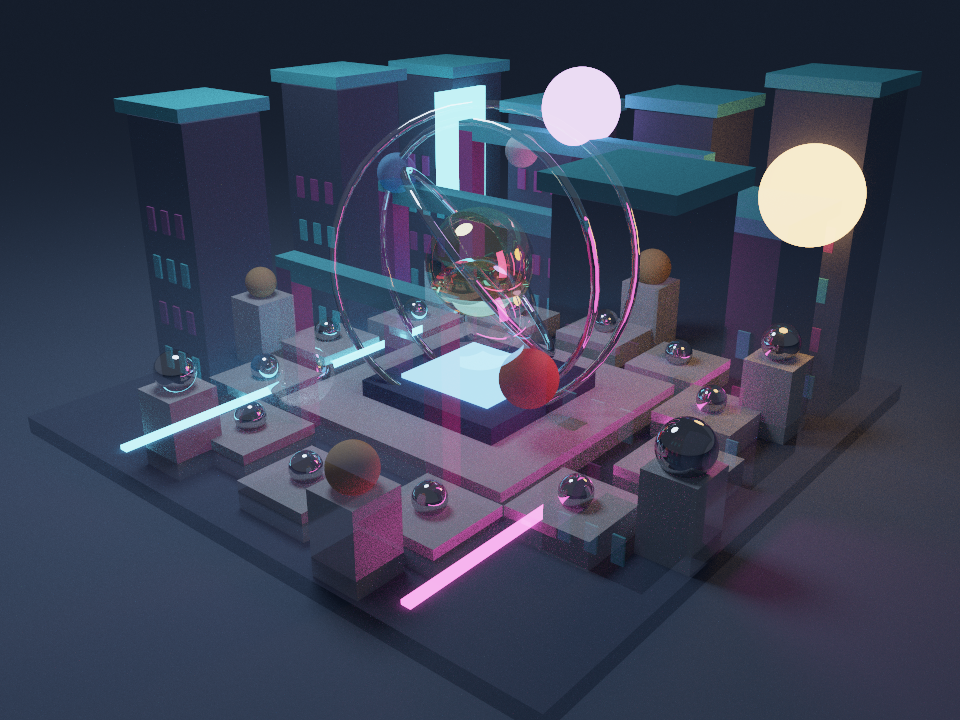 | 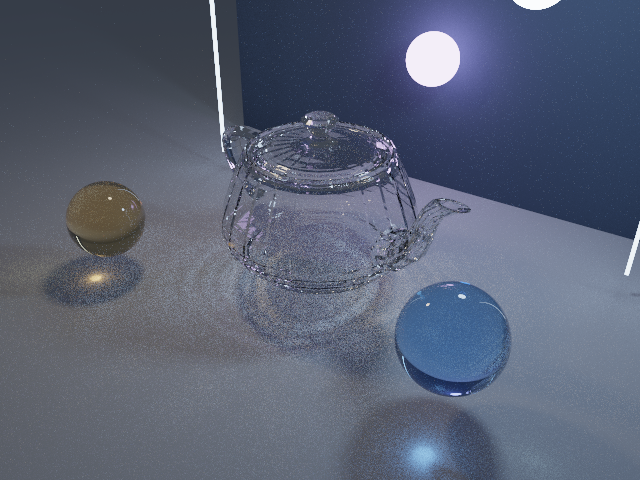 |

These are existing renderer captures; their settings are documented in the [world-collision gallery](docs/combo-gallery.md) and [glass section](#glass-tessellated-meshes-and-caustics) below. They illustrate the two experiments, rather than an equal-time comparison.

Glass meshes remain selectable in Multiworld for cross-world experiments. The fast photon estimator belongs to the Glass & caustics workspace and supports fixed worlds or independent image blends. The older camera-trained neural cache belongs to Multiworld. Glass also offers a separate photon-trained neural cache, described below. The workspaces expose these supported combinations directly.

**Reset glass showcase** restores the glass workspace defaults. Adaptive sampling remains an option in both workspaces. Explicit fixed-world/blend `--caustics` launches open the glass workspace; headless transport options retain their existing behavior. Workspace choices are kept in memory, not saved across app launches.

## What the engine shares

Both labs trace paths through the same geometry and materials, accumulate linear light, and use the same display and export pipeline. The interesting common pieces are:

- **GPU traversal and light transport.** Intersections, material scattering and path integration run in wgpu compute shaders. Each world has its own BVH in shared coordinates; the engine supports spheres, boxes, capsules, ellipsoids and embedded triangle meshes. Metal runs this on Apple Silicon, with Vulkan/DX12 backends on supported platforms.
- **A common material and lighting system.** Diffuse surfaces, tinted mirrors and smooth glass share the integrator. Glass includes Fresnel reflection/refraction, total internal reflection and distance-based colored absorption. Power-weighted area-light sampling and multiple importance sampling help paths find illumination.
- **Reconstruction that understands what is visible through glass.** Optional OIDN runs on Metal on Apple Silicon. Its normal/albedo guides follow reflection and refraction to the surfaces beyond the glass, with absorption included. Reconstruction stays separate from raw accumulation, so filtered and raw exports can be compared.
- **A GPU scheduler that spends rays where they matter.** Uniform, variance-based and denoising-aware sampling share the same camera tracer. Adaptive modes build compact ray queues on the GPU under a fixed total camera-path budget; the ray-allocation view shows the actual distribution. Extra scheduling and reconstruction work can outweigh the benefit in short runs, so adaptive sampling is optional.
- **One path from interaction to measurement.** The egui application shares the rendering GPU device; headless jobs run the same integrator without a window. Seeded scenes and sampling, raw linear readback, debug views and reproducible equal-time benchmarks make it possible to test whether an optimization improves the image.

The specialized experiments build on that foundation: Multiworld changes which scene a path queries, while the glass estimator adds light-launched paths and photon gathering. The optional neural cache learns approximate diffuse continuation in Multiworld. Their scope and bias differ; a faster-looking preview alone does not establish a more accurate light-transport estimate.

## Apple Silicon acceleration

On supported GPUs, the renderer now uses **native ray queries** for traversal and
mesh candidates. On M5, both optional neural caches can use **Metal TensorOps**,
and OIDN shares native Metal buffers without image readback/re-upload. Small
sphere scenes keep their faster software path automatically; other devices retain
the existing compute/SIMD fallbacks.

On this M5 Max, the 512×384 paired benchmark measured **2.54× faster teapot camera
tracing**, **2.21× with photon caustics**, and **2.74× for Suzanne**. The default
64-thread workgroup was retained after testing alternatives. The larger tests
also found and fixed a one-ray adaptive-budget rounding error. [Implementation,
measurement limits, controls and reproduction commands](docs/m5-acceleration.md).

## World collisions

**Overgrown sanctuary · Temple × grove.** A luminous tree grows through a broken arcade; the probability field cuts between sandstone and living branches in shared space.

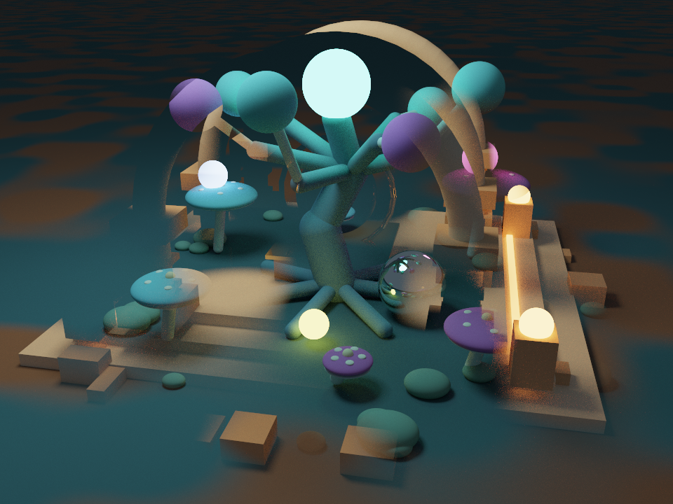

| Neon orrery · Observatory × neon | Portal garden · Neon × grove |
| --- | --- |
|  | 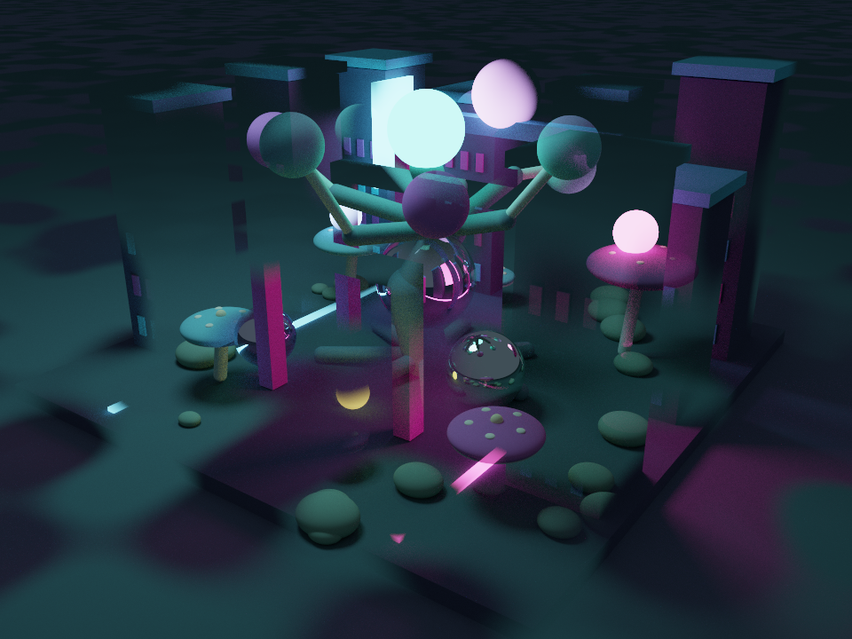 |

| Electric ruins · Temple × neon | Clockwork sanctuary · Observatory × temple |
| --- | --- |
| 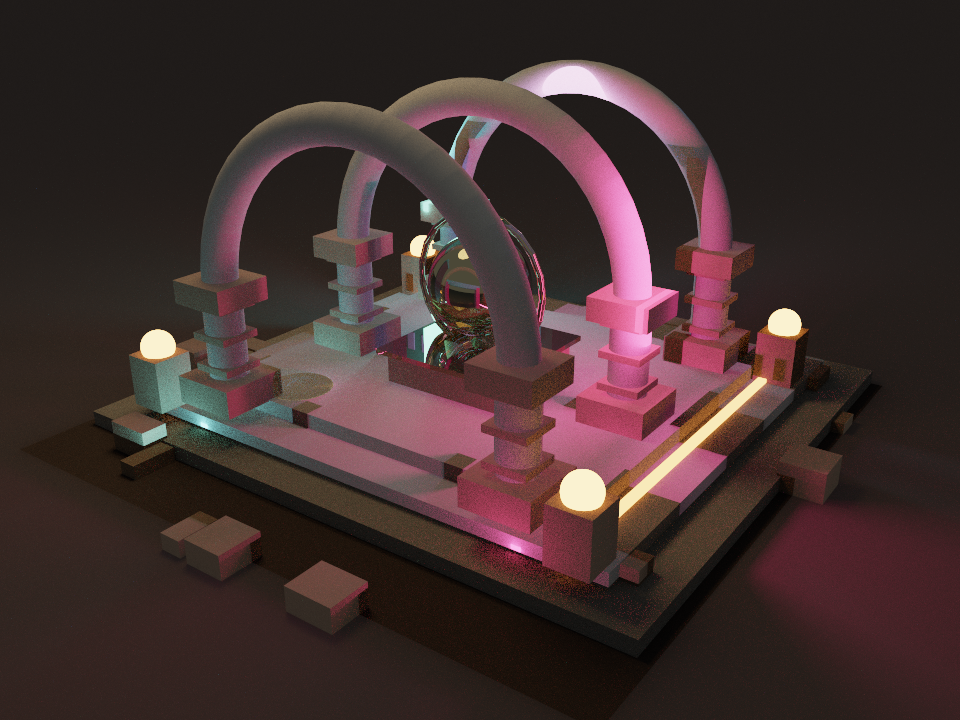 | 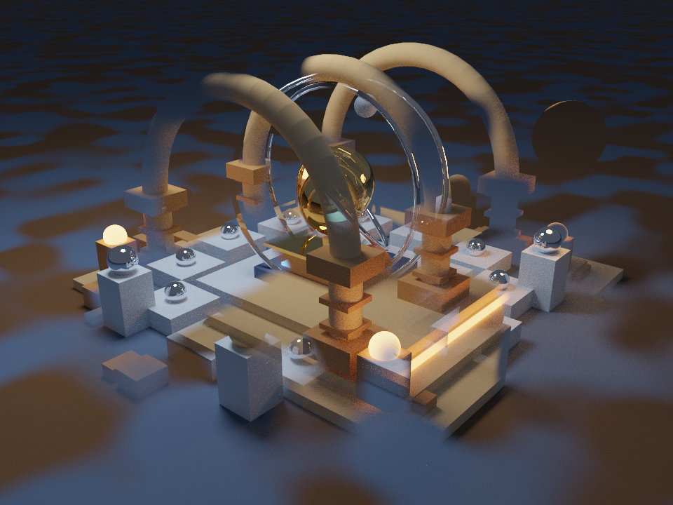 |

**Midnight forest · Grove × neon.** The grove borrows another world's light. Cyan mushroom caps, purple branches and mirror surfaces pick up the neon district's illumination and reflections.

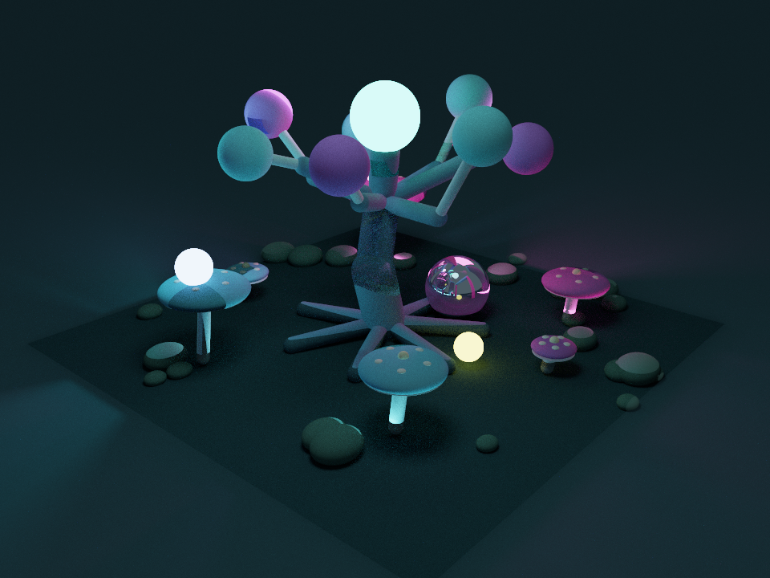

These six images were selected from **18 exploratory compositions** and rendered at **960×720, 1,024 spp, seed 42, depth 12**, with MIS enabled and denoising off. All are direct GPU PNG exports with exposure, Reinhard tone mapping and sRGB conversion. The spatial views use persistent world switching; **Neon orrery** redraws the world independently at every bounce. **Electric ruins** and **Midnight forest** lock primary rays to A and choose B for 84% of secondary segments.

[Exact camera, lighting and transport settings](docs/combo-gallery.md) accompany every capture. Reproduce all six, or explore the complete 18-shot set:

```sh
cargo run --release --example combo_gallery -- --output output/combo-gallery/final
# Quick exploration of all 18 cameras and transport recipes:
cargo run --release --example combo_gallery -- --explore --width 400 --height 300 --samples 128 --output output/combo-gallery/drafts
# Render just one recipe:
cargo run --release --example combo_gallery -- --only 15-two-realities
```

## World presets

| World | What to explore |
| --- | --- |
| Tessellated teapot · glass gallery | Online Utah Teapot mesh in clear or colored glass, with refraction and focused caustics. |
| Suzanne · crystal garden | Online Suzanne mesh, high-index crystal lenses and a luminous sculpture garden. |
| Sunken temple | Sandstone arcades, stepped platforms, a gold sun sculpture and amber lanterns. |
| Bioluminescent grove | Twisting branches, flattened mushroom caps, colored lantern pods and mossy rocks. |
| Lunar observatory | Three intersecting silver orbital rings, suspended planets and pedestal exhibits. |
| Neon district | A miniature skyline, open portal frames, cyan/magenta light rails and chrome spheres. |
| Warm spheres · original | The original warm sphere and mirror experiment. |
| Cool boxes · original | The original blue box and mirror experiment. |

<details>
<summary>Individual world previews</summary>

| Sunken temple | Bioluminescent grove |
| --- | --- |
| 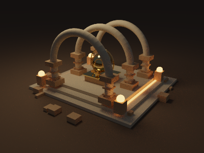 | 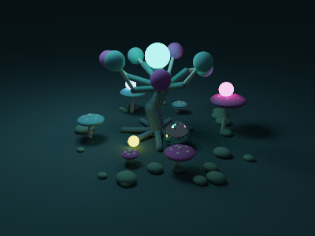 |

| Lunar observatory | Neon district |
| --- | --- |
| 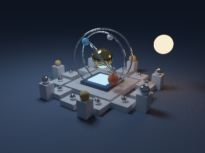 | 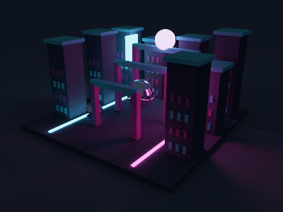 |

These are raw GPU captures at 400×300, 256 spp, seed 42; denoising is off. These four procedural worlds are generated locally: native capsule beams form arches, roots and orbital rings; ellipsoids form broad mushroom caps. The glass worlds below use bundled online meshes. No runtime asset download or external file path is required. Each set has a small number of sphere/box area lights supported by MIS.

</details>

In the **Multiworld** workspace, choose **World A** and **World B** independently from the eight presets. Both occupy the same coordinate space. **Swap A ↔ B** swaps the selected scenes while preserving the current probability, camera and transport settings. **Suggested pairings** includes Temple × grove, Observatory × neon and the original pair. Selections work in all six transport modes, with spatial probability, primary-A locking, BVHs, MIS and denoising. Changing a preset resets raw accumulation and temporal history, including while paused; changing the seed regenerates the selected presets. Choosing the same preset in both slots produces identical worlds.

```sh
cargo run --release -- --world-a lunar-observatory --world-b neon-district
cargo run --release -- --world-a sunken-temple --world-b bioluminescent-grove --spatial
# Original experiment, including the original camera and scene generation:
cargo run --release -- --world-a warm-spheres --world-b cool-boxes
```

Regenerate the four preset thumbnails (and the mixed transport views) with:

```sh
cargo run --release -- --headless --all-modes --world-a sunken-temple --world-b bioluminescent-grove --width 400 --height 300 --samples 256 --spp 8 --output output/presets/temple-grove
cargo run --release -- --headless --all-modes --world-a lunar-observatory --world-b neon-district --width 400 --height 300 --samples 256 --spp 8 --output output/presets/observatory-neon
```

Generated renders, benchmark reports, build artifacts and locally packaged apps stay in ignored `output/`, `captures/`, `target/` and `release/` directories. The curated gallery PNGs in `docs/images/` are tracked.

The CLI defaults to Temple × grove. `Settings::default()` and `scene::worlds(seed)` retain the original scenes for existing library clients and benchmark reproducibility. `scene::selected_worlds(seed, presets)` generates any selected pair. Explicit `Renderer::set_worlds` uploads remain active until a preset or seed selection changes.

<details>
<summary>Original sphere-and-box experiment gallery</summary>

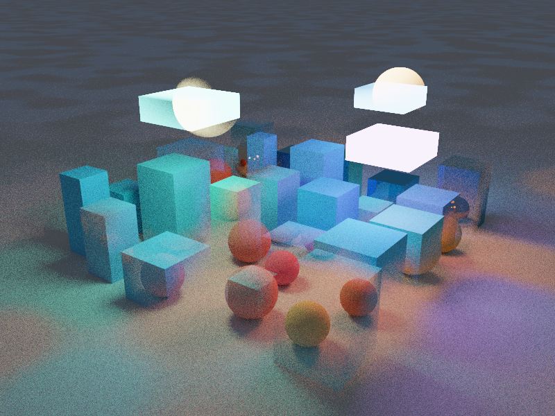

**Two incompatible worlds, one light path.** A world-space probability field selects sphere or box geometry at each segment; colored light and reflections can come from the other world.

| Independent sphere world | Independent box world |
| --- | --- |
| 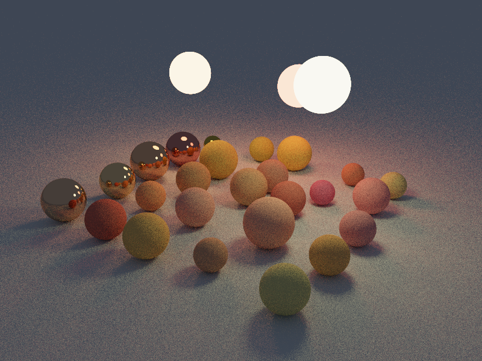 | 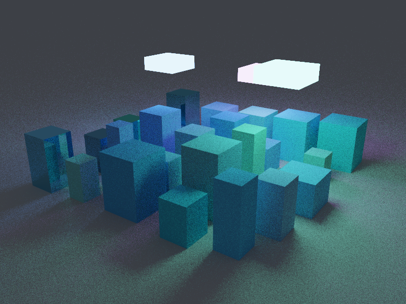 |

| Ordinary image blend | Independent switching at every bounce |
| --- | --- |
| 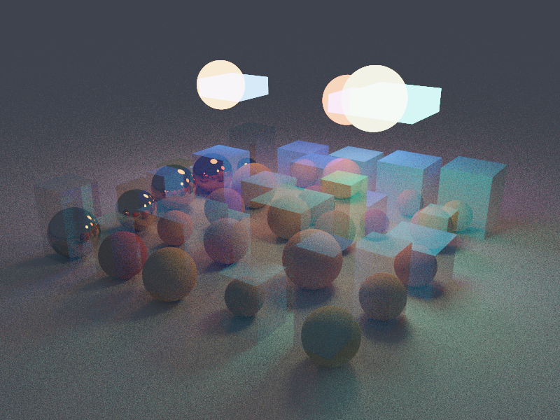 | 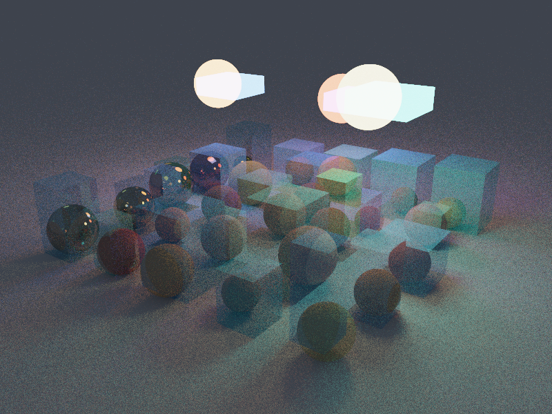 |

**Keep the visible geometry spherical, borrow another world's lighting.** Primary rays are locked to A; secondary rays choose A with probability 0.2. The cyan illumination and box-world occlusion are carried by secondary transport.

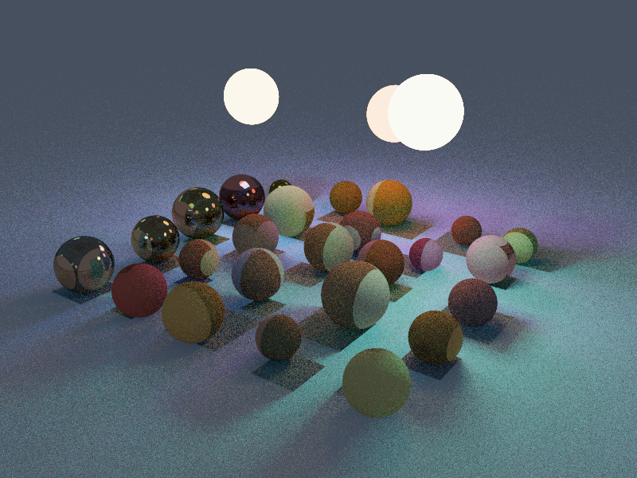

| World-space primary-selection frequency | Oriented surface normals |
| --- | --- |
| 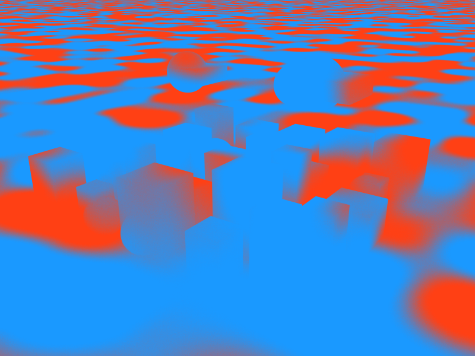 | 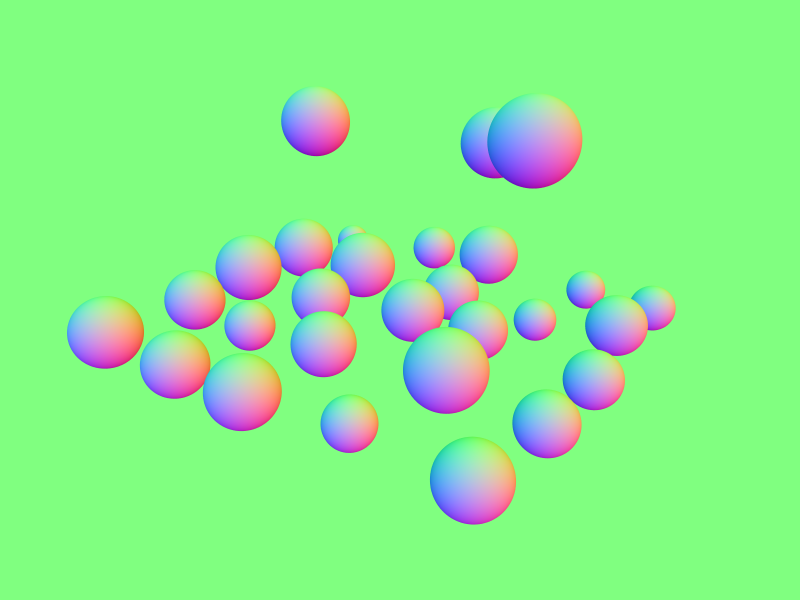 |

| Raw, 32 spp | Display filter, same 32 spp |
| --- | --- |
| 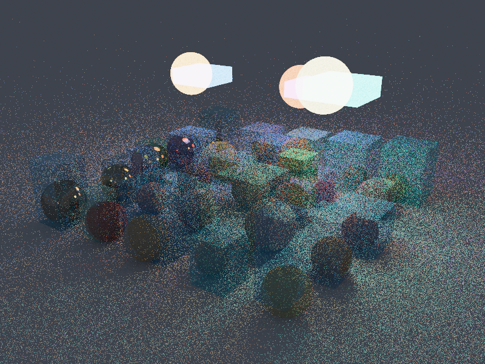 | 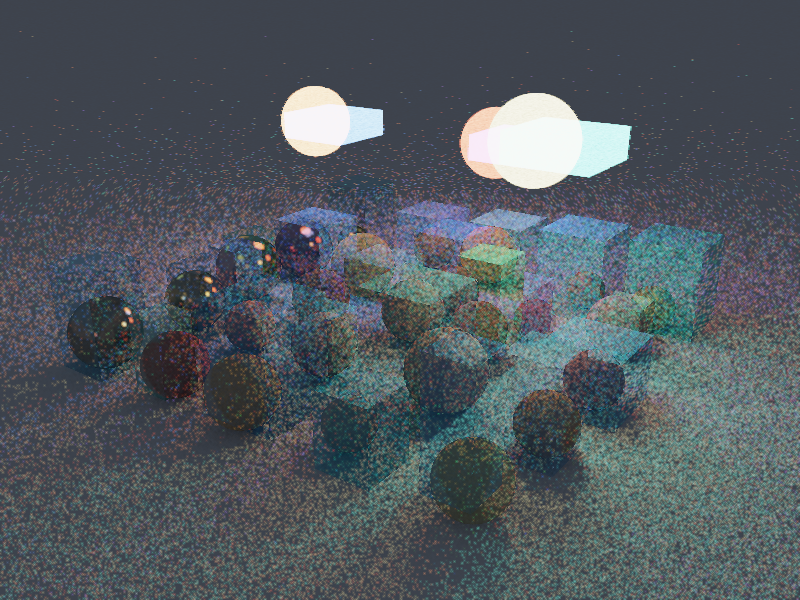 |

These are direct GPU render captures from this program. The radiance gallery uses **800×600, 512 spp, seed 42**, except the labeled 32-spp denoising pair. This older comparison uses the legacy temporal filter, which does not remove all fireflies; use raw estimates for transport comparisons. [Exact capture settings](docs/gallery-settings.md) and the [selection notes](docs/gallery-review.md) explain which images were chosen from the larger capture set. Regenerate these original-preset views with the current renderer with:

```sh
cargo run --release --example gallery -- --output output/gallery
```

</details>

## Glass, tessellated meshes and caustics

Open the **Glass & caustics** workspace to frame the online Utah Teapot and Suzanne scenes. Its **Composition** list selects Scene A, Scene B or a blend of two independently rendered scenes. **Reset glass showcase** selects a close camera, 20 bounces, **Fast glass caustics**, **Learn useful photon launches**, **OIDN**, and **Uniform** camera sampling. Each scene has its own glass selector: clear glass, borosilicate, flint crystal, diamond, amber, emerald, sapphire, or water-like refraction. The curated palette keeps a mix of materials within a scene.

| Faceted Utah Teapot · clear glass | Suzanne · emerald crystal |
| --- | --- |
|  | 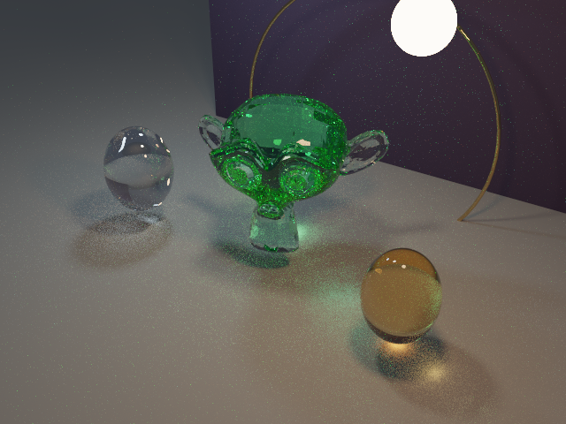 |

These two reference captures use 640×480, 1,024 spp, seed 42, depth 20, fixed World A, MIS enabled, fast caustics off and denoising off. The meshes are attributed in the asset notes below.

These are real triangle meshes with geometric face normals, Fresnel reflection/refraction, total internal reflection and distance-based colored absorption. **Fast glass caustics** aims light paths at the glass, splats sharp caustics onto visible surfaces and gathers photons for receivers seen through glass. It works in World A, World B and Image-space blend; stochastic switching uses the original camera estimator. Photon gathering has finite-radius bias, and neural caching is bypassed while this option is active. This revision uses smooth RGB dielectrics, without spectral dispersion or frosted glass.

```sh
cargo run --release -- --mode world-a --world-a glass-gallery --world-b crystal-garden --glass-a emerald --glass-b diamond --caustics --bounces 20
cargo run --release --example glass_gallery -- --samples 1024
```

On Apple M1 at 512×384 and roughly eight seconds, the teapot comparison has **18% lower full-image error** and **24% lower floor error** with fast caustics. This is a raw, equal-time comparison against a finite camera-path reference; tiny previews can trade reflection quality for cleaner caustics.

The glass workspace also offers **Manifold-guided spheres**, **Reuse successful light paths**, and an independent **Photon budget**. The sphere option solves two-interface transmission paths to guide finite emission cones; it does not implement general mesh SMS. Reuse applies weighted temporal/pool reservoir resampling, rather than the full ReSTIR FG+ architecture. All eight combinations were measured: learned launches alone won the teapot test, so they are enabled by default; the other two remain experimental and off. [Algorithms, energy checks, captures and all-combination measurements](docs/advanced-caustics.md).

**Photon-driven neural cache (paper)** adds SPPC from [Photon-Driven Neural Radiance Caching](https://doi.org/10.1145/3807895.3807923): persistent global/caustic photon queries train a multiresolution hash encoding and two 64-wide neural layers. Fused Metal matrix inference predicts diffuse continuations, including receivers seen through glass. Continued path corrections preserve shadows and fine caustics when the prediction is inaccurate, and camera movement gets an uncached preview while retaining the trained model. It is an optional alternative to Fast glass caustics; guided photons remain the default. [How to try it, paper differences, raw captures and measurements](docs/photon-driven-radiance-cache.md).

[Fast caustics: implementation, scope and benchmark](docs/fast-caustics.md) · [Glass behavior, validation and limitations](docs/glass-and-caustics.md) · [Online mesh sources and attribution](assets/README.md).

## Build and run

The [Releases page](https://github.com/arkravitz/multiworld-path-tracer/releases) offers an Apple Silicon app and command-line binary. The published **v0.2.0** download contains the original sphere/box experiment; build the current source for the world selector, glass/mesh scenes, neural cache, OIDN and adaptive sampling described here. To build from source, use Rust **1.95+** and a compute-capable GPU. Metal is used on macOS; Vulkan and DX12 are enabled on supported platforms. No CPU rendering fallback is supplied. The first build downloads dependencies; `Cargo.lock` pins the resolved versions.

```sh
cd multiworld-path-tracer
cargo run --release
```

The default render size is 800×600, independent of the window size. Start smaller on an M1 if needed:

```sh
cargo run --release -- --width 640 --height 480 --spp 1
```

Drag the image to orbit; scroll over it to zoom. Horizontal rotation wraps continuously in either direction. The Orbit control under Camera & resolution is an unlimited degree drag field, so it has no blocking endpoint. Controls provide independent World A/B presets, suggested pairings, world swapping, automatic BVH acceleration (with forced-BVH and linear reference options), all six modes, mixture probability, persistence, samples per frame, maximum depth, exposure in stops, seed, pause/resume, reset, PNG export, debug views, spatial probability, primary-world lock, camera sliders, and render dimensions. Open **Camera & resolution** and click **Apply resolution** to resize. The status area displays frame rate, accumulated spp, resolution, GPU, and backend. **UI FPS** is application presentation cadence, not a GPU timing query. Heavy paths keep at most one progressive job in flight so camera/settings changes cannot sit behind many queued glass frames; interactive jobs use one sample at a time. Headless sample budgets are unchanged.

PNG captures normally go to `captures/` relative to the working directory. Finder-launched macOS app bundles use `Pictures/Multiworld Path Tracer` in your home folder. Expand **Export folder** to choose another location, or set `MULTIWORLD_CAPTURE_DIR` before launch. They match the selected view, including exposure or debug visualization. Interactive exports prepare a current snapshot, then read back and write PNGs in the background; changing settings while preparation is pending cancels that export. Exports and tests read images back to the CPU; OIDN also stages snapshots asynchronously through a background worker. Pausing preserves the estimates; display controls still work. Changing the seed regenerates both scenes as well as restarting the sample stream.

## Experimental neural radiance caching

An optional online neural cache, based on [Müller et al.'s SIGGRAPH 2021 paper](https://research.nvidia.com/labs/rtr/publication/muller2021nrc/), can replace longer diffuse path continuations. Enable **Neural radiance cache (experimental)** in the **Multiworld** sidebar, or use `--neural-cache`; `--cache-bounce 1` tries earlier termination. It starts after a learning warm-up, conditions predictions on world identity and remaining depth, and preserves the ordinary handling of mirrors and local emission.

The compact 32→32→32→3 MLP batches ray queries into a coherent GPU queue and evaluates the complete network with fused Metal SIMD matrix operations on supported Apple GPUs, with a scalar fallback. Training uses parallel 128-example minibatches, four Adam updates per rendering dispatch, and separate EMA rendering weights. Automatic path-spread termination follows the paper's criterion. The model learns from separate teachers. An optional **Shorter training paths** mode uses bootstrapped targets with 1/16 uncached anchors, guided by NVIDIA’s public NRC integration code. Fully traced teachers remain the default because self-training can increase approximation error. NRC remains a **biased, diffuse-only adaptation**, defaulting off. On M1 it is about 1.7–1.9× faster than the initial serialized cache prototype in the open-scene test. In a separate enclosed, shadow-heavy room it beats ordinary tracing by 4.7× in World A and 1.12× in per-bounce transport after warm-up; ordinary tracing still wins on short, open paths. See the measured settings and error comparisons before choosing a mode.

```sh
cargo run --release -- --neural-cache --spp 1
# Optional anchored self-training:
cargo run --release -- --neural-cache --cache-self-training --spp 1
cargo run --release --example nrc_benchmark
# Enclosed shadow-heavy fixture, with an explicit speed check:
cargo run --release --example nrc_benchmark -- --enclosed --width 800 --height 600 --samples 16 --reference 256 --warmup 128 --require-faster
# Export inspectable, specialized Metal source, including neural_train_fused.metal:
cargo run --offline --example export_nrc_metal -- --cooperative
```

[Implementation, controls, measurements and limitations](docs/neural-radiance-cache.md) · [Paper research](docs/neural-radiance-cache-research.md). The existing display denoiser is independent; with NRC enabled, raw export contains the cached estimator.

## Denoising and adaptive sampling

Enable **Denoise** and select **OIDN · high quality**. OIDN runs on Metal on Apple Silicon; its guides follow reflections/refractions to the surfaces visible through glass, with colored absorption. The worker runs asynchronously while rendering continues. The live view holds the latest completed reconstruction at the same denoise strength used by export, so newer unfinished raw samples do not leak speckle back into it. PNG export finishes a current reconstruction without blocking the UI. The old temporal filter remains available as **Temporal · legacy**.

Source builds can install the optional native runtime with:

```sh
./scripts/install-oidn.sh
cargo run --release -- --mode world-a --world-a glass-gallery --bounces 20 --caustics --denoise --sampling denoised
```

The installer pins OIDN 2.5.1 and verifies its download checksum. Its Metal backend requires Apple Silicon and macOS Ventura or newer. The legacy filter does not need this runtime. To add OIDN and its license notices to an existing local app bundle, run `./scripts/bundle-oidn.sh` after replacing the app's executable with the current release build. Generated app bundles and downloaded libraries stay out of Git.

The **Sampling** list offers **Uniform**, **Adaptive · noise**, and **Adaptive · denoised error**. Both adaptive modes build a compact work queue on the GPU and keep a fixed total camera-path budget, spending more paths on uncertain pixels. The latter uses disagreement between OIDN reconstructions of two sample sets, with raw-variance and exploration safeguards. **View → Ray allocation** shows where paths went. Adaptive spp is an average: individual pixels receive different counts. Photon caustics keep their independent normalization.

Denoising remains approximate and can soften fine glass or caustic detail; use the strength slider and raw export to compare. Small previews and short runs can spend more on reconstruction than they gain from adaptive allocation. The default reference settings remain uniform and unfiltered. The glass workspace defaults to uniform OIDN; choose adaptive sampling explicitly to explore its tradeoffs. Changing reconstruction strength/backend preserves raw accumulation; changing sampling policy restarts it.

[Live display and responsiveness fixes](docs/live-display-and-responsiveness.md) · [Implementation, mathematical accounting, validation and measurements](docs/reconstruction-and-adaptive-sampling.md) · [Research on faster glass convergence and the next estimator upgrade](docs/glass-convergence-research.md).

In an approximately eight-second Apple M1 glass-scene comparison, OIDN reduced display-space error by 36% versus raw and 22% versus the legacy filter. Uniform OIDN beat both adaptive modes in that short test; adaptive allocation remains available to explore longer runs and other scenes.

| Raw rendering | OIDN with glass-aware guides |
| --- | --- |
| 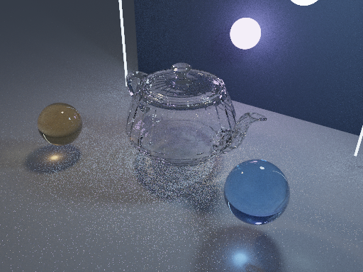 | 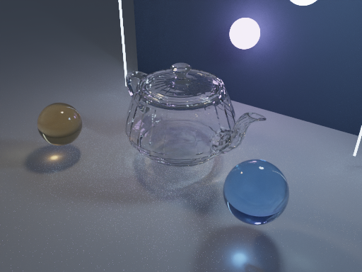 |

**Where the rays went.** Blue pixels received fewer paths; orange pixels received more. This denoising-aware run allocated **23–89 camera paths per pixel**, averaging **48 spp**, with extra work around the teapot's refracted edges and fine highlights. The heatmap shows actual path counts, not a denoiser mask.

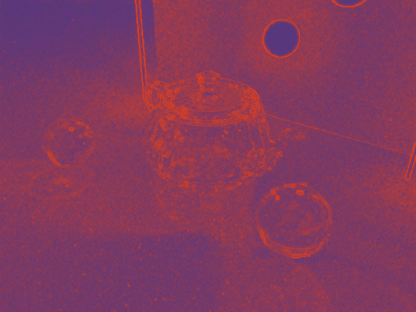

These are direct renderer exports at 512×384, seed 42, depth 20, with fast caustics enabled. The raw and OIDN images used 8.02 and 8.50 seconds respectively; the allocator view is from a separate 8.42-second run. [Full timings and error measurements](docs/benchmarks/reconstruction-512.csv) include the reconstruction cost.

```sh
cargo run --release --example reconstruction_benchmark -- --seconds 2 --reference-samples 4096
```

## Headless comparisons

```sh
cargo run --release -- --headless --all-modes \
  --width 640 --height 480 --samples 512 --spp 4 \
  --probability 0.5 --persistence 0.8 --seed 42 --output output/comparison
```

Produces six labeled PNG filenames (`01-world-a-512spp.png` through `06-persistent-512spp.png`) and `render-info.txt`, recording settings, camera, GPU/backend and elapsed time. All images use the same camera, resolution, seed, and spp. **The blend traces that sample budget in each world**, so its compute cost is approximately twice the other modes; this is equal spp, not equal time. No image-space blend is performed after tone mapping.

Render just one mode:

```sh
cargo run --release -- --headless --mode per-bounce --samples 2048 --spp 8
cargo run --release -- --headless --mode persistent --persistence 0.95 --samples 1024
cargo run --release -- --headless --mode per-bounce --primary-a --samples 1024 --output output/primary-a
cargo run --release -- --headless --mode per-bounce --spatial --samples 1024 --output output/spatial
# Exact linear reference, or force BVH even for tiny sphere-only worlds:
cargo run --release -- --headless --brute-force --samples 512 --output output/linear
cargo run --release -- --headless --force-bvh --samples 512 --output output/forced-bvh
cargo run -- --help
```

`--samples` is the total headless budget; `--spp` is samples per dispatch/frame. CLI dimensions are validated against the device's texture and storage limits. Accumulation is capped at 16 million spp to avoid exhausting the useful integer precision of f32 sums.

## What the six modes estimate

Let `p` be the probability of A, `s` the persistence, and `L_A`, `L_B` ordinary path-traced radiance in the independent scenes. Both worlds use the same constant environment `(0.045, 0.055, 0.075)`.

| Mode | World process | Expected image |
| --- | --- | --- |
| 1 · A only | Every segment queries A | `L_A` |
| 2 · B only | Every segment queries B | `L_B` |
| 3 · Image-space blend | Trace A and B independently; retain both linear estimates | `p L_A + (1-p) L_B` |
| 4 · Once per path | Choose A/B for the camera sample, keep it forever | Same expectation as mode 3, with different variance |
| 5 · Per bounce | Independently choose A/B for every ray segment, including the primary | Hybrid transport; generally differs from mode 3 |
| 6 · Persistent | Draw the initial world from p; at later segments keep it with probability s, otherwise redraw from p | A Markov hybrid process |

The transition matrix (rows = current A/B, columns = next A/B) is

```text
           A                   B
A     s + (1-s)p         (1-s)(1-p)
B       (1-s)p           s + (1-s)(1-p)
```

Thus `s=1` preserves the initial world (mode 4); `s=0` redraws independently (mode 5). A redraw can select the same world: `s` is **not** the overall probability of no switch. For constant `p`, the initial distribution `(p,1-p)` is stationary. At `p=1` or `p=0`, all mixed modes reduce to the corresponding single world, unless a probability override is enabled.

Each new segment starts at the previous hit in the shared coordinates, offset by `0.002` toward the outgoing side of its surface (opposite the oriented normal for glass transmission). The new world's geometry may contain that origin. Sphere, box, capsule and ellipsoid queries support inside-origin exit intersections, and shading treats surfaces as two-sided. The world is selected before intersection, and misses terminate consistently in the environment. Emission is accumulated as `radiance += throughput * emission`.

Diffuse directions use cosine-weighted hemisphere sampling: `f = albedo/pi`, `pdf = cos(theta)/pi`, so the throughput multiplier is exactly albedo. Mirrors use delta reflection and colored reflectance. Russian roulette starts after the fourth surface, with survival clamped to `[0.05,0.95]` and throughput divided by survival. Maximum depth truncates the estimator in every mode consistently. Importance sampling is enabled by default: finite lights use power-weighted selection, sphere solid-angle sampling, visible box-face sampling, and MIS with cosine sampling. See the sampling details below.

**Per-bounce switching defines an artificial hybrid transport process, not physically correct transport through a conventional scene.** There is no division by `p` or `1-p`: the sampler estimates that process itself. Cross-world floor-to-light, reflector-to-cube, and sphere-to-box paths are the experiment, rather than an attempt to estimate either independent world's radiance.

## Importance sampling

**Importance sampling (MIS)** defaults on in the app and headless renderer. `--no-light-sampling` restores the original cosine-only estimator and independent world-selection stream. Toggling sampling resets accumulation and temporal history.

The implementation is tuned for this renderer's small sets of area lights:

- Light selection uses a CPU-built CDF weighted by surface area times emitted luminance. Its records share each world's BVH allocation after the logical node range; no extra storage bindings, frame buffers or temporal reservoirs are required. Scene replacement rebuilds geometry, acceleration and sampling metadata together.
- Spheres are sampled uniformly over their subtended solid angle, including uniform directions for inside origins. Boxes sample visible faces weighted by area; inside origins sample all faces. Infinite emissive planes remain supported through cosine sampling.
- Fixed worlds, image blending and once-per-path selection use next-event estimation with the power heuristic. Shadow queries use bounded, early-exit traversal. Camera-visible emitters, perfect mirrors and environment misses retain their appropriate weights.
- Per-bounce/persistent switching uses **one-sample balance MIS**: a 50/50 mixture of cosine and light-directed proposals launches one continuing ray, avoiding an additional shadow traversal. Throughput uses the complete mixture density, including overlapping proposals from all finite lights. The next world is selected before evaluating the proposal and PDF. At constant probability endpoints or persistence one, it uses the same estimator as the corresponding fixed-world/per-path case.
- Initial world selection uses a randomized base-2 stratified sequence indexed by the absolute progressive sample number. Constant `p=0.5` receives equal A/B choices over aligned even-size blocks. Spatial probabilities still use each camera sample's own surface-anchored probability. Subsequent Markov transitions retain independent random draws. No world probability is divided out of radiance.

Both variants preserve depth truncation, roulette weighting and two-sided emission. The one-ray variant changes directions and thus bounce/switch debug statistics. Stratification changes initial-world samples without changing their marginal distribution. Camera and material random streams stay separate from the light RNG. Sampling is reproducible and independent of dispatch batch size.

This is a modern MIS implementation for these scenes, not a claim of a universally fastest algorithm. See [PBRT's MIS estimators](https://pbr-book.org/4ed/Light_Transport_I_Surface_Reflection/A_Better_Path_Tracer) and [power-based light selection](https://pbr-book.org/4ed/Light_Sources/Light_Sampling). [ReSTIR PT](https://github.com/NVIDIA-RTX/RTXDI/blob/main/Doc/RestirPT.md) adds spatiotemporal path reuse and reservoirs; this renderer does not implement ReSTIR.

Reproduce raw-image quality and completion-timed performance measurements:

```sh
cargo run --release --example sampling_benchmark -- --output output/sampling
```

The example warms both samplers, alternates timing order over three rounds, and writes raw RGB MSE, median GPU-completion timings and PNGs. Timing excludes readback and PNG encoding. Defaults are **160×120, 32 spp, seed 42, depth 10**, with an **8192-spp importance-sampled reference**, denoising off. The reference shares its first samples with the MIS image; finite-reference error is not zero. Results on Apple M1/Metal:

| Mode | Cosine time | MIS time | Raw MSE reduction | Error × time improvement |
| --- | ---: | ---: | ---: | ---: |
| A spheres | 5.16 ms | 8.85 ms | 3.40× | 1.98× |
| B boxes | 14.16 ms | 31.00 ms | 2.84× | 1.30× |
| Per bounce | 16.83 ms | 26.84 ms | 6.93× | 4.35× |
| Persistent | 16.70 ms | 26.46 ms | 6.44× | 4.07× |

MIS spends more time per sample. The final column is `(cosine MSE × cosine time) / (MIS MSE × MIS time)`, an efficiency measure at this budget, not a directly measured convergence-time speedup. Results depend on scenes and hardware. Large light sets may need a light hierarchy instead of the directional variant's linear PDF sum.

## Reproducing experiments

1. Run `--all-modes` at `p=0.5`, fixed seed 42, depth 10, and 512–2048 spp. Compare the red spherical world and blue box world, then modes 3–5. Look for changed occlusion, colored indirect illumination and reflections that connect geometry from different scenes. Use the importance-sampling toggle to compare against cosine-only paths; compare converged images when evaluating transport differences.
2. Compare mode 4 against mode 3. Their Monte Carlo estimates should approach the same result. Shared random numbers correlate samples for comparison but do not change either expectation.
3. In mode 6, move persistence from 0 to 1. These endpoints are coupled to the same sample streams as modes 5 and 4 respectively. Intermediate values change the joint distribution of worlds along a path.
4. Enable **Primary rays always in A** in modes 4–6. Visible primary geometry stays spherical, while secondary rays in modes 5–6 can pick up cube-world light and occlusion. In mode 4 this lock makes the entire path remain in A.
5. Enable **Use 3D value noise**, change frequency/threshold/softness, and adjust the static time offset. Selection uses trilinearly interpolated smooth value noise in world space:

   `p_A(x,t) = smoothstep(threshold-softness, threshold+softness, noise3(x*frequency + t*(1,0.37,-0.21)))`.

   For primary rays, `x` is the nearest surface point of the **union of both worlds** along that ray. Both candidates are queried before selection and reused for the selected world's first hit. This anchors the visible spatial field to surfaces: evaluating noise at the camera position would make orbiting swap the entire visible world. Rays missing both worlds use the constant `p` as a fallback. For later segments, `x` remains the **current ray origin**, including the self-hit offset. Spatial probability replaces constant `p` in mixed path modes. Modes 1–3 continue to be independent-world baselines. The primary-A lock overrides the initial selection. With spatial probabilities the constant-p stationary-distribution claim no longer applies.
6. Switch debug views without restarting. **Primary world** shows sample frequency (orange A, blue B); **World switches** counts world changes between queried segments, including a terminal miss segment, normalized by `max_depth-1`; **Bounce count** counts surface hits normalized by max depth; **Surface normals** averages the oriented first-hit normals encoded in `[0,1]` (misses are black). The blend mixes the corresponding independent debug estimates. Debug sums never contaminate linear radiance.

Exposure, debug view, denoising controls and batch size preserve raw accumulation. The blend's `p` preserves the two independent accumulators and recomposes them immediately. Transport, seed, camera and resolution changes reset invalid estimates. Other transport controls conservatively reset even when currently unused. Display uses exposure, Reinhard tone mapping and the exact piecewise sRGB transfer function; PNGs carry an sRGB chunk.

## Verification

```sh
cargo fmt --check
cargo test
# Requires GPU hardware and installed OIDN; skip the optional profiling diagnostic:
cargo test --release -- --ignored --nocapture --test-threads=1 --skip neural_gpu_phase_profile
cargo clippy --all-targets -- -D warnings
```

Sampling tests check normalized light CDFs, analytic sphere and box irradiance, inside emitters, overlapping proposals, occlusion, mirrors, depth truncation, initial-world stratification and irregular dispatch batches.

Reconstruction and allocation checks cover Metal OIDN image quality, refracted guides and Beer absorption, raw-image preservation, stale-result rejection, exact adaptive ray budgets, analytic world-mixture energy, photon normalization and denoised-error priorities. The original Apple M1 run passed 28 GPU checks. The M5 upgrade passes 38 GPU unit checks plus the separate transport integration test, in addition to the CPU suite; see [the acceleration report](docs/m5-acceleration.md).

CPU tests also check deterministic BVH structure, containment, escape links, empty/plane-only worlds, coincident objects, and invalid input. CPU tests cover sphere and slab-box intersections (front hits, inside exits, tangents, parallel axes, boundary rays, non-unit sphere rays and self-offsets), deterministic scene generation, and invalidation behavior. CPU intersection references return geometric outward normals; the shader orients these against incoming rays for two-sided shading.

The GPU tests run the actual WGSL kernel. Direct queries compare both BVH and optimized linear traversal against the original linear reference, including distance, oriented normal, color, metal flag and emission. Ray cases include inside origins from either world, parallel/signed-zero directions, grazing rays, near-parallel thin boxes, tied surfaces, empty worlds and differently sized buffers. Paired transport tests compare **all six accumulators** in every mode, at probability endpoints and intermediate/spatial settings, with both forced and automatic BVH policies. Fused and deferred presentation must produce identical PNG bytes. Invalid scene replacement is checked for atomicity. The original transport test checks probability endpoints in modes 3–6, both persistence endpoints, sample-batch independence, and preservation of blend accumulation. It also constructs an analytic two-plane experiment:

- A contains only a diffuse floor, reflectance `a=0.8`.
- B contains only a luminous ceiling, radiance `E=(2,1,0.5)`.
- Camera rays point down from above both planes; let environment radiance be `e`.

At `p=0.5`, mode 3/4 has expectation `p*a*e + (1-p)*E`. Mode 5 has expectation `p*a*(p*e + (1-p)*E) + (1-p)*E`. The extra A-floor → B-ceiling path yields a measurable radiance increase absent from ordinary blending. The test compares measured linear means with these analytic values using Monte Carlo tolerances. Endpoint tests use intentionally coupled random streams; statistical comparisons never demand bitwise equality of independently sampled images.

## Code map and performance

- `src/main.rs`: CLI and bounded headless dispatch loop.
- `src/app.rs` and `src/app/labs.rs`: separate workspace controls and session settings, winit/eframe integration, shared-GPU presentation.
- `src/gpu.rs`: buffers, compute pipelines, bounded live submissions, resource validation and explicit readback/export.
- `src/gpu/export.rs`: asynchronous interactive image readback and PNG writing.
- `src/scene.rs`: world preset catalog, original deterministic scenes and integer PRNG.
- `src/scene/presets.rs`: four procedural architectural, orbital and organic sets.
- `src/bvh.rs`: deterministic surface-area BVH construction and flat GPU node layout.
- `src/sampling.rs`: power-weighted light distributions and upload metadata.
- `src/gpu/nrc.rs` and `src/shaders/nrc.wgsl`: optional fused online neural radiance cache.
- `src/gpu/ray_query.rs`: device-gated native per-world acceleration and exact query acceptance.
- `src/gpu/tensor.rs` and `src/shaders/tensor.metal`: M5 TensorOps inference for both neural caches.
- `src/gpu/metal.rs`: owned native Metal/wgpu sharing boundary.
- `examples/nrc_benchmark.rs` and `examples/export_nrc_metal.rs`: uncached-reference comparison and inspectable Metal export.
- `examples/sampling_benchmark.rs`: raw error and completion-timed sampling comparisons.
- `examples/combo_gallery.rs`: reproducible camera and transport recipes for the world-collision gallery.
- `examples/benchmark.rs`: warmed, GPU-completion-timed reference/optimized comparisons.
- `src/settings.rs`: transport settings, camera and accumulation invalidation.
- `src/geometry.rs`: CPU intersection references for tests.
- `src/scene/mesh.rs`, `src/scene/glass.rs` and `assets/`: embedded, attributed triangle meshes and dielectric presets.
- `src/shaders/trace.wgsl`: scene-query interface, PRNG, intersections, integrator, debug accumulation and presentation.
- `src/gpu/denoise.rs` and `src/shaders/denoise.wgsl`: legacy dual-world temporal history and display filtering.
- `src/gpu/oidn.rs`, `src/gpu/oidn/native.rs` and `src/shaders/oidn.wgsl`: asynchronous Metal OIDN and reconstruction-error feedback.
- `src/gpu/adaptive.rs` and `src/shaders/adaptive.wgsl`: GPU priority scans, compact ray queues and unbiased round accounting.
- `examples/reconstruction_benchmark.rs`: reconstruction/allocation comparisons at equal elapsed time.
- `src/shaders/caustics_sampling.wgsl`: learned light/caster proposals, analytic sphere manifold shooting and weighted light-path reservoirs.
- `examples/caustics_benchmark.rs --advanced`: all eight method combinations against an independent camera reference.

Each world owns a separate geometry/material/light buffer **and its own BVH buffer**, plus native acceleration structures when supported. The following describes the portable software query; [native ray-query details](docs/m5-acceleration.md) explain the accelerated path. A deterministic surface-area split builder emits 32-byte nodes with one finite primitive per leaf. Depth-first escape links allow stackless traversal with no fixed GPU traversal-stack capacity. Bounds are padded outwards; the slab interval is conservative at grazing/parallel directions. Infinite planes stay outside finite bounds and are tested first. The original scene indices resolve equal-distance hits, so overlapping objects and planes keep the reference's tie convention.

Every ray segment starts a **fresh traversal of only its selected world**, including when its origin lies inside geometry in the other world. No previous world's node index, interval or hit is reused. Seed regeneration and custom `Renderer::set_worlds` replace geometry and acceleration together; empty worlds and scene sizes beyond the original 29 objects are supported. Invalid inputs leave both active worlds intact.

The automatic policy uses optimized linear distance queries for at most 32 finite spheres in fixed-world modes (1–3), where BVH overhead is measurable on the M1. It uses BVHs for boxes, mixed/large worlds, and stochastic modes 4–6. Using a single traversal algorithm across the stochastic world's SIMD lanes avoids the slowdown measured when mixing linear and BVH algorithms within those lanes. Uncheck **Automatic small-scene fallback**, or pass `--force-bvh`, to force both BVHs. Disable **BVH acceleration**, or pass `--brute-force`, to select the original query reference. This policy is tuned to the tested M1; other GPUs may prefer a different threshold.

Candidate queries compute only distances from geometry, with early slab rejection. Only the winner computes its full shading hit; box face ties use the reference normal routine. Six transport-specialized compute pipelines are created once at initialization. Denoiser-input variants are created once on first enable and then reused. Integer sample streams and light-transport math are unchanged by the acceleration work. Spatial mode intentionally changes the primary lookup convention as described above. Interactive accumulation also writes its final display pixel, eliminating a separate dispatch and buffer reread. Paused frames skip accumulation, and unchanged paused frames submit no compute work. Headless batches defer presentation until completion.

There is no CPU path tracer or per-frame shader compilation. Camera tracing and adaptive scheduling stay on the GPU. OIDN uses a bounded background worker with shared Metal snapshots and GPU reconstruction publication, with asynchronous host staging on other backends. Persistent radiance, guides, moments and scheduling records cost **320 bytes/pixel** (~146 MiB at 800×600), plus the display texture and separate neural, caustic and reconstruction resources. Resolution changes reallocate targets; ordinary frames reuse persistent resources. Headless jobs bound outstanding GPU work periodically.

For construction background, see [PBRT's BVH chapter](https://pbr-book.org/4ed/Primitives_and_Intersection_Acceleration/Bounding_Volume_Hierarchies). The stackless layout and separate unbounded-plane prefix here are specific to this renderer.

## Benchmarking and release binary

```sh
cargo build --release
./target/release/multiworld-path-tracer
cargo run --release --example benchmark -- --output output/benchmark-default.csv
# 253 objects/world (3×3 tiled finite geometry), camera expanded to see the tiles:
cargo run --release --example benchmark -- --tiles 3 --width 320 --height 240 \
  --samples 64 --output output/benchmark-large.csv
```

The benchmark warms all paths, rotates measurement order, waits for GPU completion at each timing boundary, and records each round as CSV. It compares the original linear reference, forced BVH, and the automatic policy, with a separate linear-reference run displaying every batch. Setup, scene building, PNG encoding and readback are excluded. This is a wall-time throughput measurement, not a hardware timestamp query. The reference also receives the common transport-kernel specialization, so ratios isolate query/presentation improvements rather than claiming to measure every optimization against the original binary. See `PERFORMANCE.md` for the recorded local results.

This is a research tool: high variance without direct-light sampling, finite-depth bias, finite-precision accumulation, and the arbitrary inside-surface convention affect interpretation. Next-event estimation for the hybrid process requires an explicit definition of which world's shadow segment is sampled; adding conventional single-world light sampling unchanged would alter the intended experiment.
