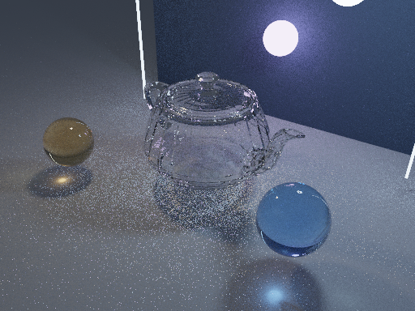
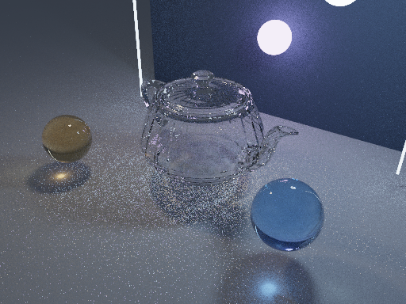

# Guided, manifold-assisted and reservoir-reused caustics

The glass workspace now exposes three independent experiments. The measured default is **fast caustics + learned photon launches + uniform camera sampling + OIDN**. Manifold guiding and reservoir reuse default off: they preserved energy in the lens test but increased raw error in the teapot comparison. These are scoped implementations, not complete ports of SMS, ReSTIR BDPT or Guided ReSTIR FG+.

| Control | Implemented scope |
| --- | --- |
| **Learn useful photon launches** | Online selection of finite lights and caster bounds from earlier photon contributions, including visible splats and gathered illumination. |
| **Manifold-guided spheres** | A bounded Newton shooting solver through two interfaces of an analytic sphere; solved directions center a normalized emission cone. Up to four smooth spheres per world. Meshes retain their ordinary proposals. |
| **Reuse successful light paths** | Weighted reservoir resampling from fresh light paths, temporal history and neighboring entries in a light-path pool. Cached physical endpoints and unnormalized flux avoid retracing the reused paths. |
| **Photon budget** | Independent light paths per active world and rendering dispatch. Zero selects automatic sizing; nonzero values are clamped to 256–32,768. Changing it resets accumulation and history. |

```sh
# Default guided photons, with reconstruction:
cargo run --release -- --mode world-a --world-a glass-gallery --caustics --denoise
# Try the other experiments, separately or together:
cargo run --release -- --mode world-a --world-a glass-gallery --caustics --denoise \
  --photon-reuse --manifold-guiding --photon-budget 8192
# Original cone-selection reference:
cargo run --release -- --mode world-a --world-a glass-gallery --caustics --no-photon-guiding
```

Library `Settings::default()` keeps these research options off for reference clients. The glass workspace and interactive/headless CLI `--caustics` choose learned launches by default. The underlying photon estimator still supports fixed worlds and independent blends; stochastic world switching retains its camera estimator. Neural caching remains separate.

## Guidance and manifold proposals

Selection probabilities are frozen for eight rendering rounds. Light selection mixes 20% of the existing power distribution with 80% learned utility; caster selection mixes 20% uniform exploration with 80% learned utility. Contributions update the next epoch's statistics. Scalar probabilities are normalized in a GPU pass, avoiding repeated normalization inside every ray. The emission direction retains the existing 10% two-sided cosine component and sums all overlapping caster-cone PDFs. Worlds with more than 32 finite lights retain the original light and caster selection distributions.

The manifold solver shoots through a selected sphere to a previously observed diffuse receiver's tangent plane. It uses two angular variables, finite-difference derivatives, at most eight Newton steps, bounded updates, and a residual test. Misses, internal-reflection failure and singular derivatives fall back to the baseline. Successful roots guide a **finite cone**, mixed 50/50 with the baseline proposal. Both components are evaluated for every drawn direction. Actual scene traversal still determines occlusion, Fresnel branches, absorption and the final landing.

This is manifold-guided emission. It does not add a direct SMS lighting term, enumerate general mesh/specular chains, or claim an inverse probability for a Newton basin. Using a root as the center of a normalized proposal avoids that missing probability and keeps the existing path partition intact. It also means that a sharp root does not itself guarantee a useful photon or a better full image. See [SMS](https://rgl.epfl.ch/publications/Zeltner2020Specular) and [the derivation notes](caustic-estimator-implementation-notes.md).

## Reservoir accounting

Each output has one fresh candidate and, within its epoch, up to three prior reservoir candidates: the same pool entry and two hashed pool neighbors. A strictly positive target combines photon power with a camera-facing, in-frame usefulness proxy. Offscreen and through-glass transport retain positive support. Reuse happens in a common light-path domain; there is no screen-space reconnection or assumed pixel-shift Jacobian.

A source contributes weight `c × W_source × h(sample)`. The fresh candidate has confidence 1; each reused source is capped at confidence 0.25 to retain independent innovation. Selection is proportional to these weights. The selected sample receives `W = total_weight / (total_confidence × h_selected)`, then its N-free flux is divided by the number of output reservoirs. Misses count in normalization. The normal photon hash and current-camera splats are rebuilt from these weighted samples.

Guides and manifold focus stay fixed within each eight-round epoch. Reservoir reuse restarts when the epoch changes; camera, scene, material, depth, budget and method changes reset it as well. This prevents replay under a proposal learned from the same retained samples. Input/output banks are separate. Reuse introduces correlation and can worsen noise even while preserving the mean. This implementation uses weighted RIS inspired by the [GRIS framework](https://research.nvidia.com/publication/2022-07_generalized-resampled-importance-sampling-foundations-restir); it does not implement the full path shifts, per-pixel reservoirs or reuse machinery of [Guided ReSTIR FG+](https://github.com/TU-Clausthal-Rendering/Guided-ReSTIR-FG-Plus).

## Equal-time results and default

Apple M1 / Metal, 512×384, Glass Gallery, depth 20, seed 42, approximately eight seconds per method, raw images without OIDN or neural caching. Each method waits for GPU completion; initial compilation is warmed outside timing. The independent 1,024-spp camera reference is imported from `reconstruction_benchmark` after validating its scene hash, camera and sample count. Its remaining noise limits accuracy. The imported reference's floor mask uses one primary-normal sample, shared across methods.

| Method | Camera spp | Seconds | Full-image NRMSE | Floor NRMSE |
| --- | ---: | ---: | ---: | ---: |
| Camera paths | 72 | 8.48 | 0.07880 | 0.44339 |
| Photon baseline | 46 | 8.15 | 0.06433 | 0.34244 |
| **Learned launches** | **48** | **8.01** | **0.06279** | **0.33256** |
| Reservoir reuse | 44 | 8.08 | 0.06707 | 0.36780 |
| Manifold guiding | 48 | 8.10 | 0.06518 | 0.35661 |
| Learned + reuse | 43 | 8.03 | 0.06788 | 0.37151 |
| Learned + manifold | 46 | 8.15 | 0.06561 | 0.35517 |
| Reuse + manifold | 43 | 8.06 | 0.06955 | 0.38799 |
| All three | 45 | 8.15 | 0.06761 | 0.37660 |

Learned launches have about **2.4% lower full-image error** and **2.9% lower floor error** than the photon baseline in this single run. This modest, scene-dependent gain supports enabling guidance by default; it is not a universal speedup claim. The other two experiments remain off. Uniform camera sampling and OIDN retain the earlier reconstruction comparison's default. The 128×96 comparison likewise favored learned launches on floor error, while reservoir combinations were noisier.

| Photon baseline · 8.15 s | Learned launches · 8.01 s |
| --- | --- |
|  |  |

[All-three raw capture](images/advanced-caustics/combined-8s.png) · [Recorded CSV](benchmarks/caustic-methods-512.csv)

```sh
cargo run --release --example caustics_benchmark -- --advanced \
  --width 512 --height 384 --reference-samples 1024 --seconds 8 \
  --reference-dir output/reconstruction-benchmark-512 \
  --output output/caustic-methods-512
# Omit --reference-dir to generate the independent reference from scratch.
```

The regression fixture compares baseline, each method and their combination on an absorbing lens. Visible caustic energy stayed within 1% in the recorded run; diagnostics require actual Newton convergence and actual reuse. A two-caster fixture learns distinct probabilities (approximately 0.647 / 0.353) while preserving the exploration floor. Reset and non-power-of-two budget changes reject old reservoir history. Shader validation checks the uniform ABI as well as WGSL validity.
