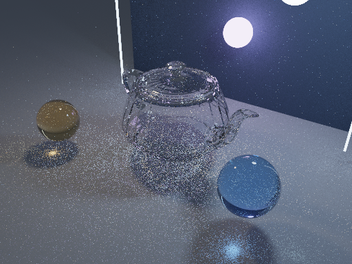
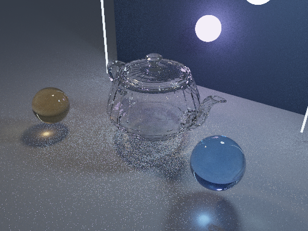

# Targeted light tracing and progressive caustics

Enable **Fast glass caustics (experimental)**, or click **Glass & caustics showcase**. The option works in World A, World B and Image-space blend. Other transport modes use the original camera estimator. The showcase also enables OIDN and denoising-aware adaptive camera sampling; choose uniform sampling and turn denoising off, or export raw PNGs, when comparing estimator variants.

```sh
cargo run --release -- --mode world-a --world-a glass-gallery --caustics --bounces 20
cargo run --release -- --mode blend --world-a glass-gallery --world-b crystal-garden --caustics --bounces 20
cargo run --release --example glass_gallery -- --caustics --samples 256 --output output/glass-fast
cargo run --release --example caustics_benchmark -- --seconds 3 --reference-samples 8192
```

## Estimator

Each camera sample launches **4,096–32,768 light paths per active world**. The budget scales with image size (the next power of two above one quarter of its pixel count, clamped to that range), so small previews do not pay the full light-pass cost. Sphere and box emitter positions are sampled uniformly over surface area, and emitters are selected by the existing power CDF. Emission is two-sided, matching the reference renderer. The direction proposal mixes 90% caster-bound cones with 10% unguided cosine emission. Each analytic glass object has a target; consecutive glass triangles form a mesh target, up to 16 bounds per world. Overlapping cones use the full mixture PDF. The unguided component retains support for specular chains outside those bounds, including mirrors.

Light paths use exact dielectric Fresnel probabilities, Beer absorption and importance transport, without the radiance-mode eta-squared factor. They follow specular surfaces until the first diffuse landing. Light selection, emission area/direction PDFs and the number of launched paths all appear in the flux weight. Truncated and escaped paths contribute zero; normalization is by launched paths, never by successful landings.

There are two exclusive ways to use a landing:

- **Directly visible receivers:** connect to the pinhole camera, test visibility, and add a pixel splat with the receiver-area / camera-pixel Jacobian. These splats have no photon density radius. They are added independently of the random primary camera hit, avoiding a second coverage mask at silhouettes.
- **Receivers reached after another camera surface:** gather position- and normal-compatible photons. This includes floors seen through glass or mirrors and caustics contributing to indirect diffuse illumination. A normalized cone kernel uses radius `0.16 * (1 + camera_samples / 64)^(-1/6)` in world units. The radius shrinks without a fixed floor as accumulation grows. This is a biased finite-radius estimate, with a bias/variance tradeoff.

A counting-sorted hash grid accelerates gathering. Bucket counts, 256-thread prefix scans and a scatter pass produce contiguous index ranges. Lookups verify the actual cell coordinates, so hash collisions cannot multiply contributions. There is one record slot per launched photon and no per-cell cap; a crowded cell costs time rather than silently dropping energy. Photon records, sorting scratch and atomic pixel splats share one allocation. Splat addition uses integer compare-and-swap, supported by the baseline Metal path.

## Path partition and scope

The light estimator owns camera paths containing a diffuse receiver followed by one or more delta events and then a sampled finite emitter (`C … D S+ L`). The camera tracer suppresses just that terminal emitter contribution. It retains direct lighting, sky/environment illumination, paths without a diffuse receiver, and all diffuse continuations. Every diffuse vertex can gather its own distinct caustic suffix. Photon depth and camera depth must fit the same maximum-bounce budget as the reference.

The neural cache is bypassed while fast caustics is active. Its full diffuse-lighting predictions overlap the photon contribution; combining them needs a separately trained residual or a different estimator partition. Display denoising still works.

The stochastic world-switching modes need an adjoint world-transition law for light paths. Independent per-world maps do not supply that law, so those modes explicitly fall back to the reference. This implementation is not ReSTIR BDPT, Specular Manifold Sampling or Guided ReSTIR FG+: it implements the targeted light-tracing / gathering recommendation from the [research survey](caustics-research.md).

Current limits include finite sphere/box emitters, smooth RGB glass, non-overlapping closed dielectric volumes and finite-kernel reconstruction. Gathering can soften small details or leak between sufficiently close, similarly oriented surfaces. Faceted geometry retains its actual optical facets. Turning the option off restores the original estimator for comparisons.

## Validation and measurement

The GPU regression checks index-matched glass, an absorbing refractive lens, the focused region as well as total image energy, and a separate glass pane between the camera and the caustic. It also checks identical direct lighting without specular surfaces, reference fallback in all stochastic modes, blend channels, neural-cache bypass, denoising and odd-sized resizing. Shader parsing/validation also runs without a GPU.

```sh
cargo test --release --lib caustic_shader_validates
cargo test --release --lib fast_caustics_ -- --ignored --nocapture
```

The benchmark excludes first-use pipeline compilation, holds geometry at seed 42, uses independent reference ray seed 1347 and test ray seed 42, and waits for GPU completion. PNG encoding and readback are outside the timed interval. It reports raw linear full-image and floor-region NRMSE against a finite camera-path reference; that reference still has Monte Carlo noise. The floor mask selects primary normals with encoded Y above 0.995. Equal camera samples are not equal work because light tracing launches additional paths.

## Apple M1 / Metal measurements

Measured 14 November 2026, teapot glass gallery, depth 20, raw images without cache or denoising. These are single-run comparisons, not a hardware-independent speedup guarantee. The 512×384 comparison uses a 1,024-spp camera reference; the small preview uses 8,192 spp. Geometry and camera are identical between estimators and their references.

| Resolution | Estimator | Completed time | Camera spp | Full-image NRMSE | Floor NRMSE |
| --- | --- | ---: | ---: | ---: | ---: |
| 512×384 | Camera paths | 8.287 s | 120 | 0.062013 | 0.411290 |
| 512×384 | Fast caustics | 8.080 s | 84 | 0.050703 | 0.312753 |
| 128×96 | Camera paths | 3.045 s | 464 | 0.038488 | 0.214372 |
| 128×96 | Fast caustics | 3.002 s | 245 | 0.039499 | 0.138416 |

At 512×384, fast caustics reduces full-image NRMSE by **18%** and floor NRMSE by **24%** at approximately equal time. In the tiny preview it reduces floor error by **35%**, while full-image error rises about **3%**: pure glass reflections still depend on camera samples, and the extra light passes cost work. The benefit depends on image size and how much error comes from caustics.

| Camera paths · 8.29 seconds | Fast caustics · 8.08 seconds |
| --- | --- |
|  |  |

[512×384 measurements](benchmarks/caustics-512.csv) · [128×96 measurements](benchmarks/caustics-128.csv)

```sh
cargo run --release --example caustics_benchmark -- --width 512 --height 384 --reference-samples 1024 --seconds 8 --output output/caustics-benchmark-512
```

Primary architecture reference: [NVIDIA's caustics implementation notes](https://github.com/nvpro-samples/vk_gltf_renderer/blob/main/docs/caustics.md). The implementation here was written for this renderer's WGSL/Metal transport and does not depend on NVIDIA libraries.
