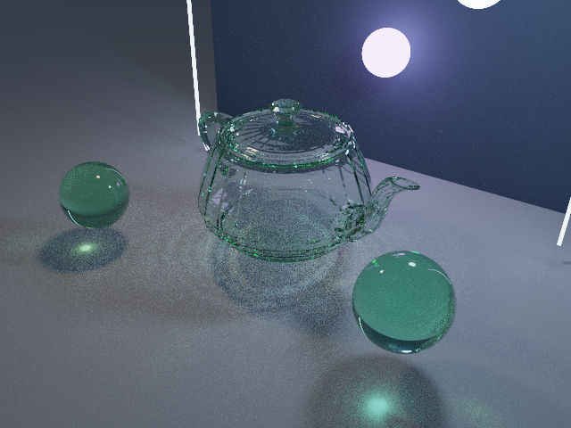

# Faceted glass, online meshes, and caustics

Open the **Glass & caustics** tab at the top of the sidebar. Scene A selects the tessellated Utah Teapot gallery; Scene B selects the Suzanne crystal garden. Both use real online triangle meshes, embedded in the app. Choose a glass type under the active scene selector, or choose a two-scene blend. For stochastic cross-world glass experiments, use the separate **Multiworld** workspace; fast photon caustics stay disabled there.

The materials include clear glass, borosilicate, flint crystal, high-index diamond, amber, emerald, sapphire, and water-like glass. **Curated glass palette** retains the scene's individually selected materials; any other choice replaces its glass materials with the chosen optical preset. The IORs and RGB absorption colors are illustrative presets, not measured spectral datasets.

The glass workspace defaults to fast caustics with learned launches, OIDN and uniform camera sampling, which won our short equal-time comparison. Adaptive modes remain selectable. See [reconstruction and sampling](reconstruction-and-adaptive-sampling.md). **Reset glass showcase** restores yaw 0.6, pitch 0.55, distance 13, depth 20 and exposure +0.25 EV. Glass needs enough bounces to enter and exit multiple walls. Accumulation and the display denoiser are useful for clean images; raw export retains the unfiltered estimate.

## What the renderer computes

- Exact unpolarized dielectric Fresnel reflection/transmission probabilities, Snell refraction and total internal reflection.
- RGB Beer-Lambert absorption by traveled distance inside glass, rather than a color multiplier at each interface.
- Radiance-mode eta-squared transport factors, compensated in Russian roulette.
- Entry/exit from geometric winding. A glass-only BVH query resolves camera-inside rays and origins that switch worlds inside a dielectric.
- True path-traced caustics: diffuse continuation rays can pass through specular glass and reach emitters. Direct-light visibility treats glass as an occluder; those bent light paths are evaluated by continuation sampling. There are no painted bright spots or straight-through transparent-shadow shortcuts.

This is an RGB, smooth-interface dielectric model. It does not implement spectral rainbow dispersion, rough/frosted transmission, or a general stack for overlapping/nested dielectric volumes. Mesh volumes should be closed and non-overlapping. World switching remains the app's artificial transport process rather than a physical material boundary. The diffuse neural cache skips glass interfaces; it can still approximate later diffuse continuations.

The optional **Fast glass caustics** pass adds targeted light tracing, visible receiver splats and progressive photon gathering for fixed worlds and image blending. It partitions caustic paths away from camera continuation to avoid double counting; neural caching is bypassed while active. See [implementation and benchmark](fast-caustics.md). With the option off, or in stochastic switching modes, caustics use ordinary camera-path continuation and can remain noisy for many samples.

## Mesh implementation

The official University of Utah 2026 Teapot export has an interior and properly connected handle/spout geometry. Suzanne comes from Khronos' CC0 sample assets. Source details, processing and attribution are in [assets/README.md](../assets/README.md).

The scene parser fan-triangulates OBJ faces and supports positive/negative face indices. Each flat-shaded triangle uses the existing 64-byte object ABI and per-world BVH. Triangle edge data occupy the otherwise unused emission slots; triangle meshes are not emitters. Explicit tests ensure those edges never contribute radiance or enter the light-sampling distribution. Analytic primitives and existing worlds retain their layouts.

```sh
cargo run --release -- --mode world-a --caustics --world-a glass-gallery --world-b crystal-garden --glass-a emerald --glass-b diamond --bounces 20
cargo run --release --example glass_gallery -- --samples 1024
cargo test --release --lib glass_ -- --ignored --nocapture --test-threads=1
```

The GPU checks cover analytic Fresnel values, Beer absorption through a sphere including an index-matched medium, total internal reflection, triangle BVH/linear agreement, finite results in all six world modes, refractive light focusing versus an index-matched control, and skipping glass in neural diffuse-cache queries. CPU checks validate OBJ indexing, mesh topology, dielectric input ranges and scene invalidation.

Optical reference: [PBRT v4, Dielectric BSDF](https://pbr-book.org/4ed/Reflection_Models/Dielectric_BSDF).


## Captures



This raw capture uses 640×480, 1,024 spp, seed 42, depth 20, fixed World A, MIS enabled, no neural cache and no denoising. All glass in the teapot scene is replaced with the emerald preset. The README shows the curated clear-glass palette and the Suzanne crystal garden at the same camera and sample budget.

The supplied meshes are embedded model data, not online dependencies at run time. The separate [asset attribution](../assets/README.md) identifies the original models and describes the changes made to prepare closed glass boundaries.

The optional [advanced caustic methods](advanced-caustics.md) add analytic sphere manifold guiding, weighted light-path reservoir reuse and an independent photon budget. Learned launch selection is enabled by default; the two other experiments remain off after equal-time testing.
