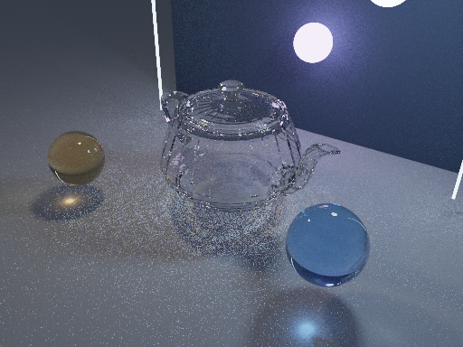
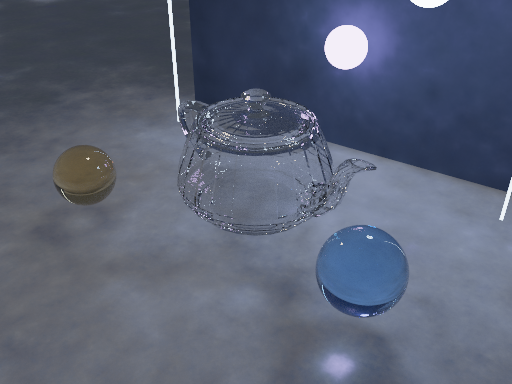

# Photon-driven neural radiance caching for glass

The Glass & caustics workspace now has **Photon-driven neural cache (paper)**, an implementation of the SPPC training method from Stamm, Kneiphof and Klein's [Photon-Driven Neural Radiance Caching](https://doi.org/10.1145/3807895.3807923), with a Metal/software-traversal backend. The [authors' implementation](https://github.com/julcst/photon-nrc) and [equation/configuration notes](photon-nrc-paper-notes.md) describe the source method.

This is a separate estimator from Fast glass caustics and the older Multiworld neural cache. Enabling it disables those two estimators and uses uniform camera sampling. It supports Scene A, Scene B, and independent image blends. Glass interfaces, Fresnel reflections, absorption, tessellated meshes and camera-visible specular chains are still traced explicitly. The network predicts the continuation at the first diffuse surface, including a floor seen through glass. Continued camera-path corrections keep its approximation from permanently erasing shadows or focused illumination.

## Try it

Select **Glass & caustics → Photon-driven neural cache (paper)**. The photon/query budgets and both initial gathering radii are adjustable. The initial preview traces complete camera paths while collecting training queries; cache use starts after 32 valid optimizer updates and at least eight fully traced samples of the current view. Learning continues while rendering. Camera changes restart the image but retain world-space learning and collect a new eight-sample uncached preview; scene, material and transport resets clear the model.

```sh
cargo run --release -- --mode world-a --world-a glass-gallery \
  --world-b crystal-garden --photon-nrc --denoise --bounces 20

# Explicit M1 preset; budgets are per rendering round, photons per active world:
cargo run --release -- --mode blend --world-a glass-gallery \
  --world-b crystal-garden --photon-nrc --photon-nrc-photons 32768 \
  --photon-nrc-queries 2048 --photon-nrc-hash-log2 14 --bounces 20
```

The existing guided-photon estimator remains the showcase default. The photon teacher and neural prediction are approximate. The corrected renderer retains half of diffuse continuations and applies inverse-probability residual weights, so those approximations cannot permanently erase illumination in the expected raw image. Individual residual samples can be negative and noisy; they must not be clamped before accumulation. This costs more than terminating every path at the cache. Lower noise alone does not establish better accuracy. OIDN remains independently available and receives the renderer's existing reflection/refraction-aware albedo and normal guides.

## What runs on the GPU

1. Sample a persistent ring of camera-visible diffuse queries; replace approximately 2% each round.
2. Build a compact spatial index of those queries with count, prefix-scan and scatter kernels.
3. Trace power-weighted finite-light paths through diffuse, mirror and dielectric events. Each photon considers every eligible nearby query and uniformly selects at most three, with inverse-selection weighting. Retain 30% of global photons with compensating flux weights; keep caustic photons.
4. Update independent global and caustic progressive photon statistics. Both radii shrink with `alpha = 2/3`. Normalize by all emitted paths since the query's birth, including paths that missed. The previous scattering event determines global versus caustic classification.
5. Produce outgoing-radiance targets, factor by `albedo + 0.01`, and train a 16-level, two-feature trilinear hash encoding with a 64 → 64 → 64 → RGB ReLU network. Use relative luminance L2, Adam and a frozen EMA inference model.
6. Resolve coherent batches of camera queries. Metal's cooperative 8×8 matrix operations evaluate both hidden layers, with 16 queries per group and 8 KiB of shared activation storage. A scalar kernel supports other adapters. Training fuses forward/backward work per minibatch item.

Ordinary photon splats/gathers remain disabled. Half of eligible diffuse paths terminate at the frozen cache prediction N; the other half trace the full suffix L and contribute 2L − N. Thus the conditional expectation is L, rather than the approximation N. Prefix emission is included once, and the inference resolver accepts signed cache scales. A separate camera-sampled sky/unsampleable-emitter suffix supplies sources that finite-light emission cannot represent. World identity, normal compatibility and remaining path depth are checked before query-reservoir selection.

## Differences from the authors' configuration

| Component | This renderer | Authors' glass configuration |
| --- | --- | --- |
| Query acceleration | Software BVH traversal plus compact hashed query grid | RTX ray tracing/query acceleration |
| Persistent queries / emitted paths | 2,048 / 32,768 per round by default | 32,768 / 524,288 |
| Training | One update, batch 128 | One update, batch 32,768 |
| Position encoding | 16 trainable levels × 2 features; hash log2 14 default, configurable 10–19 | 16 × 2; hash log2 19 |
| Encoded inputs | 64 including world/depth and padding; diffuse-only material features | 60 with general material/direction features |
| Initial radii | Global 0.25, caustic 0.08 in our scene units | Global 0.06, caustic 0.03 in their scene units |
| Optimizer | Adam 0.01, beta1 0.9, beta2 0.99, epsilon 1e-15, EMA 0.95; decoupled hash weight decay | Same Adam/EMA settings, coupled L2 regularization |

The hash decay avoids normalized Adam steps on untouched tiny features. The model predicts Lambertian receiver radiance because the engine's other lobes are ideal mirrors and smooth dielectrics. Those delta events remain explicit paths; this does not add rough/glossy cached BSDF support. The M1 preset uses about 15 MB of model/query storage, plus 128 bytes per display pixel for the inference queue. Query counts round up to a power of two. The full hash-log2-19 setting uses much more memory and is not the M1 default.

## Camera-motion regression and correction

The initial implementation terminated every eligible path after 32 training updates. Its first image mixed fully traced warmup samples with later neural estimates. Rotating cleared those accurate image samples, leaving an undertrained approximation by itself. In a controlled shadow scene, the first post-orbit frame retained only **47%** of reference ground-shadow contrast.

The current renderer uses an independent 50% correction coin and the frozen inference model: `N + B/0.5 * (L − N)`. The network remains trained by SPPC; this path-based residual is a deliberate quality safeguard beyond the paper's termination-only configuration. An eight-sample uncached preview after image resets also protects newly exposed regions while learning continues. The regression measures both the first post-orbit image and the subsequent corrected image, rather than merely checking that query memory survives camera motion.

```sh
cargo test --release --lib photon_nrc_ -- --ignored --nocapture --test-threads=1
```

## Historical termination-only measurements

**The timings, error scores and captures below predate the path-correction fix. They describe the original experimental implementation, not the performance or quality of the current corrected mode.**


Apple M1/Metal, 512×384 teapot scene, depth 20, seed 42, raw linear RGB, denoising off. Both methods use the same scene, camera and finite 1,024-spp independent camera reference. Each measured interval waits for GPU completion. Shader/scene setup is excluded. The floor mask is based on primary normals and is not a caustic-only mask. Lower NRMSE is better; the noisy reference is not ground truth.

| Excluded learning | Estimator | Timed seconds | Camera spp | Image NRMSE | Floor NRMSE |
| --- | --- | ---: | ---: | ---: | ---: |
| 0 s | Guided photons | 8.13 | 46 | 0.06395 | 0.33834 |
| 0 s | SPPC neural cache | 8.08 | 49 | 0.08298 | 0.45978 |
| 0 s | Guided photons | 8.13 | 46 | 0.06395 | 0.33834 |
| 10 s | SPPC neural cache | 8.14 | 43 | 0.05991 | 0.28109 |
| 0 s | Guided photons | 8.02 | 78 | 0.05126 | 0.26519 |
| 30 s | SPPC neural cache | 8.06 | 72 | 0.04598 | 0.20045 |

The cold-start cache is worse in this short test. Only SPPC receives excluded training time in the warmed pairs; the guided-photon rows start fresh. GPU throughput varied between runs, so compare rows within each pair. After 30 seconds of training, the cache's subsequent eight-second image has about **10% lower overall error and 24% lower floor error**, with slightly fewer camera samples. This establishes a warmed-image improvement for this scene, **not an end-to-end speedup including training** or a reproduction of the paper's RTX timings.

| Guided photons, eight seconds | SPPC, 30 s training + eight seconds |
| --- | --- |
|  |  |

The cache removes much of the floor speckling but still has broad spatial artifacts and loses some fine caustic structure. Recorded paired measurements ([cold](benchmarks/photon-nrc-cold.csv), [10 s](benchmarks/photon-nrc-10s.csv), [30 s](benchmarks/photon-nrc-30s.csv)) accompany these captures.

```sh
cargo run --release --example caustics_benchmark -- \
  --photon-nrc --advanced --only photon-guiding,photon-nrc \
  --width 512 --height 384 --reference-samples 1024 --seconds 8 \
  --cache-warmup-seconds 30 --output output/photon-nrc-comparison
# Use --cache-warmup-seconds 0 to include cold learning in the measured interval.
# Add --reference-dir output/reconstruction-benchmark-512 to reuse a validated reference.
```

Validation covers analytic diffuse target normalization, progressive radius reduction, emitted-path/query lifetimes, actual hash learning, retained learning on camera resets, scalar versus cooperative inference, and caustic/world isolation in independent blends. The additional orbit regressions check ground-shadow contrast and actual lens-focused caustic energy after the view changes. Finite-depth and Monte Carlo error remain; the old termination-only scores do not validate the corrected mode.
