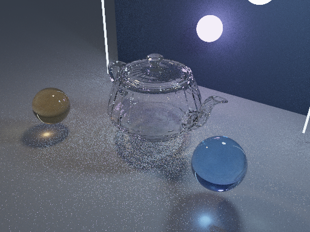
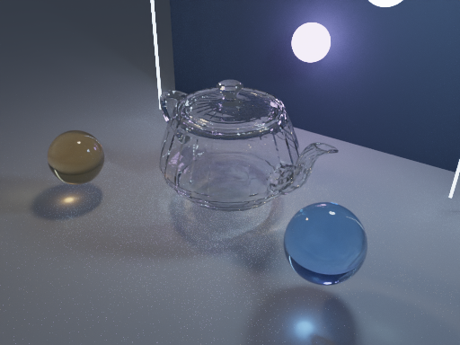
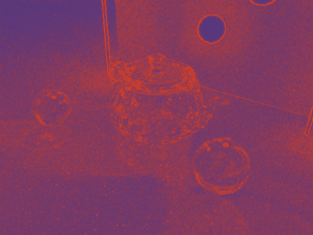

# OIDN reconstruction and adaptive camera sampling

Click **Glass & caustics showcase** to enable OIDN, corrected glass guides, fast caustics and **Adaptive · denoised error**. The Sampling list also offers uniform sampling and variance-based adaptive sampling. **View → Ray allocation** shows actual camera path counts: blue receives fewer paths, orange receives more. The counter reports average spp when allocation varies by pixel.

```sh
./scripts/install-oidn.sh
cargo run --release -- --mode world-a --world-a glass-gallery --bounces 20 --caustics --denoise --sampling denoised
# Compare a simpler allocator or the original reference:
cargo run --release -- --mode world-a --world-a glass-gallery --bounces 20 --caustics --denoise --sampling variance
cargo run --release -- --mode world-a --world-a glass-gallery --bounces 20 --caustics --denoise --sampling uniform
# The old filter remains available for comparison:
cargo run --release -- --denoise --denoiser temporal
```

## OIDN and glass guides

The integration dynamically loads **Open Image Denoise 2.5.1** and explicitly selects its **Metal** device on macOS. The installer downloads the official Apple Silicon package and verifies its pinned SHA-256. Project-local libraries live in ignored `.deps/`; the native app can bundle them in `Contents/Frameworks` with `scripts/bundle-oidn.sh`. `OIDN_LIBRARY_PATH` overrides discovery for another OIDN 2 runtime. OIDN's Metal backend requires a supported Apple GPU and macOS Ventura or newer. Without the optional runtime, ordinary rendering and the legacy filter remain usable; selecting OIDN reports the missing dependency rather than pretending to use it.

Each traced camera path records the normal and albedo of its first non-delta surface, following perfect reflection and refraction. Guide albedo includes mirror tint and distance-based glass absorption. Fresnel branch sampling gives reflected/transmitted guide contributions; the averages remain antialiased instead of being renormalized. If roulette ends radiance before a diffuse receiver, a guide-only delta continuation finishes its features without adding radiance or extra debug bounces. This avoids guide holes in glass with several interfaces. A miss contributes a zero normal and its accumulated guide transmittance.

The worker prefilters noisy normal and albedo inputs, then runs OIDN's high-quality HDR `RT` filter with `cleanAux`. A blend reconstructs A and B separately before applying the current blend weight. World switching reconstructs its actual mixed-path signal.

Input packing runs on the GPU. Readback is asynchronous, and copying the mapped inputs and calling OIDN happen on a bounded background worker. OIDN itself runs on Metal; this integration uses host staging rather than direct native Metal-buffer sharing. A completed snapshot retains its original sample weight while newer raw samples remain visible. Generation stamps reject results from earlier cameras, scenes and resolutions. Exporting a PNG waits for reconstruction of the current snapshot. Raw export bypasses OIDN and preserves the unfiltered linear estimator.

OIDN is a single-frame neural reconstruction, not a temporal video denoiser. It may soften small caustic details, introduce small reconstruction bias, or fluctuate while the camera moves. Correct guides help but cannot supply light paths that were never sampled. The legacy temporal backend remains available. With adaptive sampling it uses the full progressive estimate for its spatial preview, rather than treating unequal pixel samples as uniform temporal history.

## GPU adaptive sampling

The first **16 average spp** use uniform camera sampling. Subsequent rounds estimate luminance variance with Welford moments and use path bounce counts as a cost proxy. A relative-noise priority is bounded to `[0.2, 1]`. This retains exploration everywhere and bounds a valid pixel's request to approximately six paths per round.

GPU prefix scans turn priorities into a cumulative distribution. Systematic resampling allocates exactly `width × height` camera samples per round. A second scan compacts the active pixel list, then the tracer dispatches indirectly over that queue. It loops over each active pixel's assigned paths. The host never reads pixel priorities to decide which rays to trace. Odd dimensions and global scans spanning several workgroups are covered by GPU tests.

Per-pixel integer counters drive independent camera sample streams. A blend traces its allocated camera ray in both worlds, preserving its existing per-world budget semantics. Stochastic world modes use independent world choices when sampling adaptively, so allocation cannot predict a future stratified world choice from past observations. Uniform sampling retains the original stratified sequence.

The adaptive image is **not** a naively stopped per-pixel sample average. For expected rate `r`, predictable prior mean `m` and allocated samples `L_j`, each fixed-budget round adds:

`m + Σ_j (L_j − m) / r`

Every pixel receives the predictable term, including inactive ones. Systematic resampling has expected count `r`; the weighted residual restores the correct conditional expectation. Raw signed residuals remain available for numerical comparisons and are clamped only for display or neural reconstruction inputs. This avoids introducing optional-stopping bias from allocating rays according to their earlier results. It does not remove the existing bias of neural caching or finite-radius photon gathering.

**Visible photon splats keep their own global accumulation.** They are updated for every pixel each round, regardless of camera allocation. Camera moments and split-sample banks exclude those splats. Receivers reached through glass still gather photons along their allocated camera paths. Sampling therefore cannot dim or amplify a caustic simply by changing that pixel's camera count.

All six world modes support adaptive camera sampling. Fast photon caustics retain their fixed-world/blend scope. Adaptive NRC rendering uses scalar inference because a queued pixel can contain several camera paths; uniform rendering retains the grouped Metal matrix inference path. Neural training remains enabled when compatible with the existing caustic/NRC partition.

## Denoising-aware allocation

Even and odd camera samples form two interleaved estimates. Both include the same visible-photon estimate, so independent photon-splat noise does not masquerade as a problem that extra camera rays can fix. The OIDN worker reconstructs both estimates using the same prefiltered guides. Their disagreement, adjusted for the split counts and denoise strength, estimates reconstruction uncertainty. It is converted to per-ray equivalent variance before publication, so an older prior does not grow merely because more camera samples arrive.

A GPU pass stabilizes that prior over a small neighborhood; this filters the priority map, not the rendered image. The allocator uses the reconstructed uncertainty with a **10% raw-standard-deviation safeguard** and its exploration floor. Thus a smooth-looking reconstruction cannot permanently shut off sampling in a region that has not discovered a rare light path.

The extra split reconstructions run at most approximately every **750 ms** during interaction; ordinary OIDN refreshes can run more frequently. Explicit final reconstruction also refreshes the error estimate. These are uncertainty-based priorities, not a proof of the image's exact remaining MSE or an automatic stopping criterion. The implementation uses split reconstructions; it does not reproduce the neural-network derivative estimator in Firmino et al. or require training a new sampler network.

## Validation

CPU validation covers the shared shader ABI and display-versus-sampling invalidation. GPU checks cover:

- Known-image OIDN error reduction and edge retention, independently for both world inputs.
- Refracted guide normals and Beer absorption, unchanged raw samples, and rejection of stale scene results.
- Exact camera budgets, distinct active queue entries, priority-driven allocation, constant-radiance preservation, paused resets, odd dimensions and scans spanning more than 256 blocks.
- Analytic world-mixture energy and unchanged visible-photon accumulation under adaptive sampling.
- Actual OIDN uncertainty publication, allocation driven by denoised error rather than raw variance alone, and all world modes with neural caching and the legacy preview.

```sh
cargo test --release
cargo test --release -- --ignored --nocapture --test-threads=1 --skip neural_gpu_phase_profile
cargo run --release --example reconstruction_benchmark -- --seconds 2 --reference-samples 4096
```

The benchmark holds geometry and camera fixed, uses independent reference ray samples, warms pipelines and OIDN outside timing, and includes GPU completion and reconstruction of the current snapshot inside timing. It writes raw/reconstructed NRMSE, actual pixel path ranges, images and allocation maps. The finite camera reference still contains noise. Extra reconstruction work and queue overhead can outweigh allocation gains, especially in tiny images or short runs; evaluate equal elapsed time rather than equal spp.

## Measured glass-scene comparison

Apple M1 / Metal, 512×384, Glass Gallery, 20 bounces, fast caustics, strength 0.8. Each method targets eight seconds after warming; the reported time includes GPU completion and final reconstruction, which can overrun that target. The independent 1,024-spp camera-only reference avoids using the photon approximation as its own reference. HDR error is normalized RMSE; display error is RMSE after the same exposure, tone map and sRGB conversion. Lower is better.

| Method | Average camera spp | Seconds | HDR error | Display error | Actual paths/pixel |
| --- | ---: | ---: | ---: | ---: | ---: |
| Uniform, raw | 80 | 8.02 | 0.05168 | 0.04576 | 80–80 |
| Uniform, legacy temporal | 76 | 8.17 | 0.06953 | 0.03749 | 76–76 |
| Uniform, OIDN | 68 | 8.50 | 0.04766 | 0.02938 | 68–68 |
| Adaptive noise, OIDN | 56 | 8.63 | 0.04829 | 0.02979 | 18–76 |
| Adaptive denoised error, OIDN | 48 | 8.42 | 0.04900 | 0.02995 | 23–89 |

OIDN reduces display error by about **36% versus raw** and **22% versus the legacy filter** in this run. Uniform OIDN wins this short comparison. Adaptive allocation demonstrably moves paths toward difficult regions, but its queue and uncertainty-reconstruction costs outweigh that benefit here. Keep uniform sampling available; these measurements do not establish a universal speedup for adaptive rendering. At tiny 160×120 previews, full-strength OIDN also softened fine features enough to worsen HDR error despite removing grain.

| Raw, 8.02 seconds | OIDN, 8.50 seconds |
| --- | --- |
|  |  |



[Recorded measurements](benchmarks/reconstruction-512.csv). Reproduce with:

```sh
cargo run --release --example reconstruction_benchmark -- \
  --width 512 --height 384 --reference-samples 1024 --seconds 8 \
  --output output/reconstruction-benchmark-512
```

## References

- [OIDN documentation: input images and perfect-specular guides](https://www.openimagedenoise.org/documentation.html#input-images).
- [OIDN official binary downloads](https://www.openimagedenoise.org/downloads.html).
- [Denoising-Aware Adaptive Sampling, Firmino et al., SIGGRAPH 2023](https://graphics.ucsd.edu/~henrik/papers/daas.pdf).
- [Forget Superresolution, Sample Adaptively, Bálint et al., SIGGRAPH 2026](https://balint.io/fssa/). A separate learned sampler/denoiser architecture; not implemented here.
